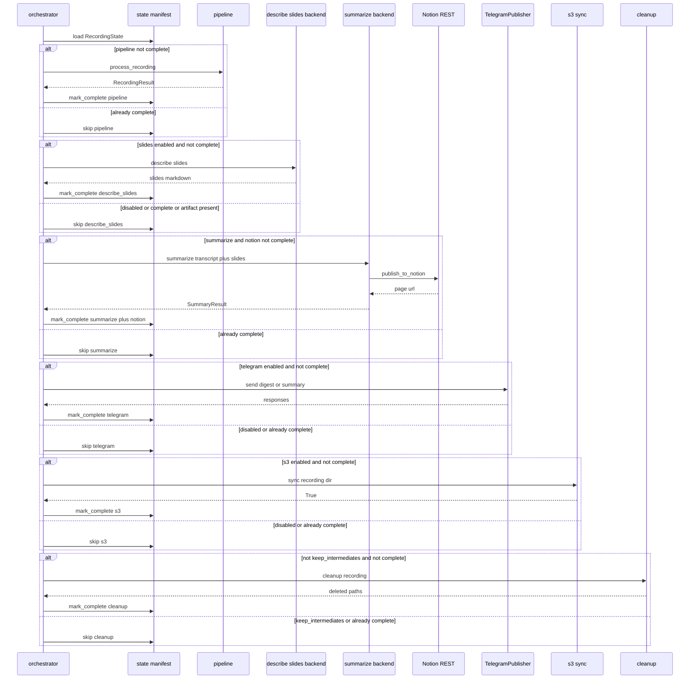

# OSS Companion Transcriber Engine

The transcriber engine is a local-first Python CLI that turns `.mp4` recordings
into a plain-language transcript, an optional slide-description markdown block,
a summary plus Telegram digest, a Notion subpage, a Telegram notification, and
an optional S3 sync. The engine is composed of three separable concerns:

1. **Configuration** — a validated dataclass model loaded from
   `.json`/`.yaml`/`.yml`, with secrets referenced by environment-variable
   *name* only and resolved at use time.
2. **Deterministic media pipeline** — child-process stages (ffmpeg audio
   extract, optional scenedetect slide/scene extraction) plus the single
   network seam inside the pipeline: OpenRouter speech-to-text transcription.
3. **Manifest-gated orchestrator** — the paid/network post-transcript stages
   (`describe_slides`, `summarize` plus Notion, Telegram, S3, cleanup) that run
   only after the pipeline and are guarded by a per-recording
   `<name>.transcriber_state.json` manifest.

The two post-transcript model stages each select a pluggable backend from
config. `describe_slides` always runs on the `openrouter` vision backend.
`summarize` runs on the single `agno` backend: two direct OpenRouter
chat-completions calls produce the summary and digest, then the engine publishes
the Notion subpage directly via the Notion REST API with no MCP and no model
tool-calling.

> **Boundary:** the `pipeline` stage mixes offline child processes (ffmpeg,
> scenedetect) with one network call (OpenRouter STT transcription delegated to
> `transcriber.backends.transcribe_openrouter.transcribe_recording`). The
> paid post-transcript work (slides vision calls, summary calls, Notion,
> Telegram, S3) lives in the manifest-gated orchestrator step `_process_one`,
> where each stage is individually skipped when its manifest entry is already
> complete.

## Entry points

- `transcriber [--config PATH] [--keep-intermediates] [--dry-run]` — load
  config, pre-flight check, discover new recordings, run the batch, print a
  batch summary, exit non-zero if any recording failed.
- `transcriber check [--config PATH]` — run the pre-flight check standalone
  (exit 0 when all required binaries and env vars are present, non-zero
  otherwise).

Dry-run prints the execution plan (including Notion server and parent page,
Telegram chats, and S3 bucket and profile where enabled) and performs no side
effects. `--keep-intermediates` is also toggled persistently when
`config.debug` is true. Config resolution order is `--config`, then
`TRANSCRIBER_CONFIG`, then the `transcriber.config.yaml` and `config.yaml`
candidates in the working directory.

### Pre-flight check

`__main__.py` implements the pre-flight check as `preflight_check`, which
verifies required binaries on `PATH` (via `shutil.which`) and required
environment variables (by resolving the env-var *name* through `resolve_env`).
OpenRouter is now **mandatory**: a missing `openrouter` config section fails
fast because transcription runs over its HTTP seam.

Required binaries depend on enabled stages:

- `ffmpeg` is always required.
- `scenedetect` is required when `config.stages.slides.enabled`.
- `aws` is required when S3 sync is enabled.

There is no `agy` binary requirement: the legacy `agy` CLI backend has been
removed and `agent.cli` / `agent.extra_args` remain only as ignored
compatibility fields.

Required env vars depend on config:

- The Telegram bot token env, only when the Telegram stage is enabled
  (`telegram.enabled`).
- The OpenRouter API key env (always, because transcription uses the OpenRouter
  HTTP seam).
- The Notion token env, only when `summary.backend == "agno"` and
  `config.notion.token_env` is set.

## Configuration model

Configuration is loaded in `transcriber/config.py` into a single validated
dataclass. Both `.json` and `.yaml` map to the same model. Secrets are never
stored in the model; the config references them by env-var name only and
`resolve_env` resolves them at use time.

Notable model pieces:

- `SlidesStage` — `enabled` plus `backend` (only `"openrouter"` is allowed;
  validated at load).
- `Stages` — `slides: SlidesStage` and `s3_sync: bool`.
- `Transcribe` — `model_id`, `diarize`, `segment_seconds`, `overlap_seconds`.
- `Summary` — `language`, `sections`, `backend` (only `"agno"`).
- `Agent` — `output_file` (templated with `{basename}`); legacy `cli` and
  `extra_args` fields are accepted but ignored.
- `OpenRouter` — `api_key_env`, `base_url`, `slides_model`, `summary_model`,
  `max_slides`.
- `Notion` — `server`, `parent_page_id`, `insert`, `token_env`.
- `Telegram` — `bot_token_env`, `default_chat_id`, `routing`,
  `topic_descriptions`, `enabled`.
- `S3` — `bucket`, `profile`.
- `Timeouts` — per-stage timeouts including `ffmpeg`, `scenedetect`, `slides`,
  `transcribe`, `summarize`, and `s3`.

Config validation enforces:

- `slides.backend` must be `"openrouter"`; any other value raises at load and
  again in `_get_slides_backend` rather than falling back silently.
- `summary.backend` must be `"agno"`; any other value raises in
  `get_summarize_backend` with no silent cross-backend fallback.
- The `openrouter` section is unconditionally required (it backs transcription
  as well as slides and summarize).
- `notion.token_env` is required when `summary.backend == "agno"`.

## Deterministic media pipeline

`transcriber/pipeline.py` ports the deterministic media stages using the `duct`
library. Each child process is wrapped with a configurable timeout drawn from
`config.timeouts`. Each stage is idempotent: a step whose output already exists
is skipped. The pipeline returns a structured `RecordingResult` listing which
artifacts are new.

Stages, in order:

1. **Audio extract** — `ffmpeg` mp4 to mp3.
2. **Slide/scene extraction** (optional, when `config.stages.slides.enabled`)
   — `scenedetect`.
3. **Transcribe** — audio is diarized and chunked into explicit time slices,
   each slice sent to the OpenRouter speech-to-text API, and the slices are
   stitched back into `<name>.txt` (plain readable transcript, no timestamp
   markers).

The per-recording driver is `process_recording(mp4, config)`, which returns a
`RecordingResult(name, mp4, new_artifacts, skipped_artifacts)`.
`process_all(config)` runs it over every `.mp4` under `config.recordings_dir`
in sorted order.

### Pipeline boundary

The pipeline stays ffmpeg plus scenedetect plus transcribe. It does **not**
call the slides or summarize backends. Those live in the manifest-gated
orchestrator step (`_process_one`). Concretely:

- The slides backend is not called from `pipeline.process_recording`.
- The summarize backend is not called from the pipeline.

The one network seam inside the pipeline is the OpenRouter STT call via
`transcriber.backends.transcribe_openrouter.transcribe_recording`, invoked from
`pipeline._transcribe`.

### Stage helpers

- `_extract_audio(mp4, mp3, timeout)` — mirrors the source ffmpeg flags.
- `_extract_slides(mp4, slides_dir, scenes_csv, timeout)` — mirrors the source
  scenedetect command.
- `_transcribe(mp3, txt, config)` — delegates to
  `transcriber.backends.transcribe_openrouter.transcribe_recording`, which
  chunks the audio, transcribes each part via the OpenRouter
  `/audio/transcriptions` seam (diarized when `config.transcribe.diarize`),
  stitches and reconciles speakers, and writes a speaker-attributed
  `<name>.txt`.

`_run_command` is the sole seam through which the pipeline invokes external
binaries. Tests monkeypatch it to avoid spawning real processes.

## Per-recording state manifest (idempotency)

Idempotency is driven by `transcriber/state.py`, which gives each recording a
sidecar JSON manifest `<name>.transcriber_state.json` living next to the
`.mp4`. The manifest — not artifact existence alone — is the source of truth
for stage completion.

Canonical ordered stages tracked by the manifest:

1. `pipeline`
2. `describe_slides`
3. `summarize`
4. `notion`
5. `telegram`
6. `s3`
7. `cleanup`

`describe_slides` runs (when `stages.slides.enabled`) the configured slides
backend to produce `<name>.slides.md` before summarize consumes it.

`summarize` and `notion` are marked complete together because the single
`agno` backend run performs both: it writes the local artifacts first, then
publishes the Notion subpage. They are tracked separately so a future split
does not break the manifest schema.

`RecordingState` persists after each `mark_complete(stage)` call, so a crash
between stages still leaves an accurate manifest for the next retry. A corrupt
or unreadable manifest is treated as nothing complete; individual stage guards
(artifact-exists checks and the Notion publish-record sidecar) keep the retry
safe. Pre-existing manifests written before `describe_slides` existed simply
lack that key; because completion is read as `_completed.get(stage, False)`,
an absent entry is treated as incomplete and the stage runs exactly once on
retry.

## Orchestrator and manifest-gated stages

The orchestrator is `_process_one` in `transcriber/__main__.py`. It runs each
stage in order, honoring the state manifest, and catches exceptions
per-recording so the batch continues. Cleanup runs only on a recording's full
success (unless intermediates are kept).

*The diagram shows the manifest-gated runtime flow from pipeline through
cleanup.*

### Stage: describe_slides

When `config.stages.slides.enabled` and the manifest is not complete, the
orchestrator:

1. Selects the slides backend via `_get_slides_backend(config)` (only
   `openrouter`).
2. Builds slide inputs via `build_slide_inputs(mp4.parent, name)`.
3. Reads the transcript text from `<name>.txt`.
4. Calls `backend.describe(slides, transcript_text, config,
   timeout=slides_timeout)`.
5. Writes the result to `<name>.slides.md` and marks `describe_slides`
   complete.

If `<name>.slides.md` already exists (for example from a prior crash after
write but before mark), the orchestrator skips the paid call and marks
complete. If slides are disabled, it logs and skips. An empty slide set or an
empty model response writes an empty `<name>.slides.md` and still completes;
it is not an error.

The slides backend is **image-only**: the transcript argument satisfies the
`SlidesBackend` protocol but is intentionally unused. Transcript
cross-referencing is the summarize stage's job. Each slide is sent in its own
OpenRouter vision call carrying a single image and no transcript; the
per-slide markdown is concatenated.

#### describe_slides is only openrouter

`_get_slides_backend` returns `OpenRouterSlidesBackend()` when
`config.stages.slides.backend == "openrouter"`, and raises `ValueError`
otherwise. Selection is validated at config load; an unexpected value here
raises rather than silently falling back.

### Stage: summarize + notion

When the manifest is not complete for both `summarize` and `notion`, the
orchestrator:

1. Reads the prepared slide markdown from `<name>.slides.md` if slides were
   enabled and the file exists; otherwise `None`.
2. Selects the summarize backend via `get_summarize_backend(config)` (pure
   function of `config.summary.backend`).
3. Calls `backend.summarize(transcript_path, slides_markdown, mp4.parent,
   config)`.
4. Marks both `summarize` and `notion` complete.

`slides_markdown` is embedded when non-empty and omitted when
`None`/empty/whitespace. When slides are disabled, a stale
`<name>.slides.md` is never fed into the summary — treated exactly like
slides-off.

The `agno` backend produces the summary and digest with two direct OpenRouter
chat-completions calls, writes `<name>.md` plus `<name>.telegram.md` plus
`<name>.slides-clean.md` from the model output, then publishes the Notion
subpage through the engine-side REST client. File writes happen **before** the
Notion publish so a crash between publish and manifest mark leaves local
artifacts intact; a `<name>.notion_published.json` publish-record sidecar
prevents a retry from creating a duplicate Notion page.

The summarize-stage timeout is `timeouts.summarize` when set, otherwise the
default timeout. The blocking OpenRouter and Notion calls run in worker threads
so the outer `asyncio.wait_for` bound can still cancel the run. An empty or
absent summary fails the stage. Summarize plus Notion publish happen in a
single run, so a Notion failure fails the whole `summarize` plus `notion`
stage.

#### Notion publishing: direct REST, not MCP

The engine publishes via `transcriber.backends.notion_publish.publish_to_notion`
— no MCP server, no model tool-calling. This avoids the Notion-MCP-over-OpenRouter
tool-schema incompatibility (models returning empty completions with zero tool
calls when handed the official MCP server's `oneOf`/`anyOf`/`$ref` schemas).

The direct REST path:

1. Extracts the parent **page id** from `notion.parent_page_id` (accepts either
   a bare id — hyphenated or not — or a full Notion URL with the id embedded).
2. Converts the Markdown summary into Notion **block** objects, **losing
   nothing**: headings, paragraphs, bullet/numbered list items, blockquotes and
   fenced code blocks map to their native block types; anything else falls back
   to a paragraph block so all text survives.
3. Creates a new subpage under the parent (title is the recording basename)
   with up to the first 100 blocks, then appends the remainder in
   at-most-100-block chunks (Notion caps children per request at 100).
4. When cleaned slide descriptions are supplied, creates a child page titled
   `Slide Descriptions` **under the summary page** holding the slide blocks, so
   the summary page stays short and the long slide detail lives one click away.

Secrets: the token is resolved by env-var *name* (`notion.token_env`) at use
time and is **never logged**. The `transcriber.backends.notion_mcp` helper
(stable official-server launch, merged env, restricted publish toolset) is
retained and tested but is not on the current summarize hot path, which uses
the REST client instead.

### Stage: telegram

When Telegram is enabled (`telegram.enabled`) and the manifest is not
complete, the orchestrator sends the digest or full summary via
`TelegramPublisher(config).send(message_text)`.

It prefers the concise digest the summarize backend wrote for chat; falls back
to the full summary only if the digest is missing or empty.

Notion publishing via the Bot HTTP API:

- Resolves the bot token from the environment variable **named** in
  `config.telegram.bot_token_env` (never a literal secret).
- Routes a message to a chat id based on its topic: matched topics use
  `config.telegram.routing[topic]`; unmatched or unidentified topics fall back
  to `config.telegram.default_chat_id`.
- Chunks messages that exceed Telegram's per-message character limit into
  multiple `sendMessage` calls.

When `telegram.routing` is non-empty, the orchestrator partitions the full
summary into one digest per topic plus a default remainder with a single model
partition call (`build_routed_digests`), writes each non-empty bucket to
`<name>.telegram.<topic>.md`, and routes it to its chat. A partition failure
falls back to the single-digest-to-default path so a routing hiccup never drops
the notification. When every bucket comes back empty, the orchestrator falls
back to the single digest as well.

Message language is decided upstream (per `config.summary.language`); the
caller supplies the final text and this module only routes and sends it.

Telegrams are sent with no `parse_mode`, so Markdown syntax would otherwise
render literally. The module strips Markdown to clean plain text before
sending: `**bold**`/`__bold__`/`*italic*`/`_italic_` become inner text;
`` `code` `` becomes inner text; leading `#` heading markers are removed;
`-`/`*`/`+` list bullets become the `•` glyph; `> quote` becomes quoted text;
`[text](url)` becomes `text (url)`; `` becomes `alt (url)`; fenced
code fences are removed.

When `telegram.enabled` is false, the orchestrator skips the stage entirely
and pre-flight does not require the bot token env var.

### Stage: s3

When S3 is enabled and the manifest is not complete, the orchestrator calls
`s3.sync(mp4.parent, config)` and marks `s3` complete.

S3 sync is a gated stage: it is a no-op (returns `False`) when
`config.stages.s3_sync` is falsy or when `config.s3` is `None`. When enabled it
executes `aws s3 sync <local_dir> <config.s3.bucket> --profile
<config.s3.profile>` through `duct`, enforcing `config.timeouts.s3` seconds.

Ordering contract: a successful `sync` MUST complete before any
cleanup/deletion of intermediates. This module only performs the upload;
`transcriber.cleanup` is a separate function the orchestrator calls *after*
`sync` returns `True` (or after it is skipped on a run where S3 is disabled).

### Stage: cleanup

Cleanup runs only on success (unless intermediates are kept). It is a separate
function the orchestrator calls after a recording's publish (and, when S3 is
enabled, a successful `sync`) has completed. This module performs no upload
itself; sequencing sync-before-delete is the orchestrator's responsibility.

What is kept:

- source `<name>.mp4`
- final `<name>.md` summary
- `<name>.txt` speech-to-text transcript
- `<name>.slides-clean.md` reader-facing slide descriptions (markers stripped —
  the durable slides output)

What is deleted:

- `<name>.mp3`
- `<name>.telegram.md` plus per-topic `<name>.telegram.<topic>.md` digests
- `<name>.slides.md` (the markers-kept slide-description **debug**
  intermediate; its cleaned counterpart `<name>.slides-clean.md` is kept)
- `<name>.notion_published.json` (the `agno` publish record)
- `extracted_slides.<name>/` directory (which also holds `<name>.scenes.csv`)
- `transcribe_work.<name>/` directory (which holds the OpenRouter STT chunk
  parts `part_*.mp3` and the `segments.json` resume manifest)

The `keep_intermediates` flag (surfaced by the CLI as `--keep-intermediates`
and persistently by `config.debug`) disables all deletion.

## Backends

`transcriber/backends/__init__.py` surfaces the public backend API:

- Interfaces: `SlidesBackend`, `SummarizeBackend`, and the `SlideInput` /
  `SummaryResult` data types.
- Errors: `SlideDescribeError`, `SummarizeError`, `TranscribeError`.
- The shared OpenRouter vision helper `_openrouter_vision` (used by the slides
  `openrouter` backend).
- Concrete backends: `OpenRouterSlidesBackend`, `build_slide_inputs`,
  `get_summarize_backend`.

`transcriber/backends/interfaces.py` defines two small, pure `Protocol`
interfaces selected per-stage by config:

- `SlidesBackend` — turns extracted slide images (+ transcript context) into a
  `<name>.slides.md` markdown block.
- `SummarizeBackend` — turns the transcript (+ the slide markdown) into
  `<name>.md` plus `<name>.telegram.md` and publishes to Notion.

### SlideInput

`SlideInput` is a single extracted slide plus its scene timing:

- `image_path`: path to the slide JPEG.
- `timestamp`: human-readable `MM:SS - MM:SS` scene range, or the string
  `"unknown"` when the timing could not be resolved from the scenes CSV. Timing
  is never omitted.

### SummaryResult

`SummaryResult` is paths to the two files a summarize backend writes:

- `summary_path`: `<name>.md`
- `telegram_path`: `<name>.telegram.md`

Both files are written by the backend; the engine reads them back
(file-is-source-of-truth contract).

### SlidesBackend.describe

`describe(slides, transcript_text, config, *, timeout)` returns the
slide-description markdown.

An empty slide set or a valid empty backend response both resolve to `""`; a
transport/format failure raises `SlideDescribeError`.

### SummarizeBackend.summarize

`summarize(transcript_path, slides_markdown, recording_dir, config)` writes
both files and publishes the Notion subpage.

`slides_markdown` is embedded when non-empty and omitted when
`None`/empty/whitespace. The `agno` backend publishes directly via the Notion
REST API.

## Slides backend (openrouter only)

`transcriber/backends/slides.py` implements the `describe_slides` backend.
`openrouter` is the only slides backend.

`OpenRouterSlidesBackend` issues **one OpenRouter vision call per slide** (via
the `_openrouter_vision` helper), turning each extracted slide JPEG into part
of the `<name>.slides.md` markdown block. The descriptor is **image-only**: it
never receives the transcript.

`build_slide_inputs` lists the extracted slide JPEGs in a deterministic order
and joins each to its scene timing parsed from the scenes CSV that scenedetect
writes **into the slides dir**
(`extracted_slides.<name>/<name>.scenes.csv`), never a `.mp4` sibling.

Design invariants:

- **Empty semantics:** an empty slide set returns `""` with **no** HTTP call; a
  valid empty/whitespace backend response returns `""` (not an error). A
  transport/format failure raises `SlideDescribeError`.
- **One call per slide:** each slide is sent in its own vision call carrying a
  single image and no transcript; the per-slide markdown is concatenated.
- **Per-slide timestamps:** each slide's message carries a `Timestamp: MM:SS -
  MM:SS` text part placed **immediately before** its `image_url` part. Unknown
  timing is passed as the literal `unknown` — never omitted.
- **Downscale:** each JPEG is downscaled to a bounded long edge before base64
  to control size/cost. This is a size control, **not** redaction.
- **Deterministic ceiling:** module constants cap the max slide count
  (overridable via `openrouter.max_slides`, default 60) and the max total
  encoded bytes; exceeding either raises `SlideDescribeError` **before** any
  HTTP call. Over-ceiling decks hard-fail (no chunking).
- **Log hygiene:** logs carry stage/model/slide-count/elapsed only — never the
  API key, headers, or image bytes.
- **No pipeline coupling:** the backend is not called from
  `pipeline.process_recording` — the pipeline stays ffmpeg plus scenedetect
  plus transcribe only. It runs in the manifest-gated orchestrator step.

The slides backend no longer *drops* empty slides — it keeps the model's
output (markers included) in `<name>.slides.md` so empty scenes stay
identifiable. Stripping markers plus stray placeholders happens later, in
`transcriber.agent.clean_slide_descriptions` and
`transcriber.agent.append_slide_descriptions`, only for the summary, Notion,
and cleaned-slides outputs.

## Summarize backend (agno only)

`transcriber/backends/summarize.py` selects the single summarize backend:

- `AgnoSummarizeBackend` — lives in `transcriber.backends.summarize_agno` and
  is imported **only when selected** (so the optional `agno` dependency is not
  a base import on unrelated paths). It produces the summary plus digest with
  direct OpenRouter model calls, then the **engine** publishes the Notion
  subpage directly via the Notion REST API
  (`transcriber.backends.notion_publish.publish_to_notion`) — no MCP, no model
  tool-calling. Use `get_summarize_backend` to obtain the configured backend.

There is no `agy` summarize backend in current code; the former `agy` CLI
backend has been removed. Selection is a pure function of
`config.summary.backend`; there is **no silent cross-backend fallback**.

`get_summarize_backend` lazily imports `AgnoSummarizeBackend` for `"agno"`.
An unknown value raises.

The shared prompt helpers live in `transcriber/agent.py` (now prompt and
slide-stitching helpers, not a CLI runner): language directives, section
checklists, non-XML transcript fencing, digest and routing prompt builders,
`digest_path_for` / `slides_clean_path_for`, and the deterministic
`append_slide_descriptions` stitching that keeps large slide blocks out of the
model's bounded output budget.

## OpenRouter shared seam

`transcriber/backends/openrouter.py` hosts the single HTTP seam used for every
OpenRouter chat-completions call: `_openrouter_chat` plus the
slides-backend wrapper `_openrouter_vision` that raises `SlideDescribeError`.

Behavior:

- `POST {base_url}/chat/completions` with the caller-provided messages and
  model, honoring `timeout`.
- Headers: `Authorization: Bearer <key>` (key resolved by env-var name), plus
  OpenRouter's optional `HTTP-Referer` and `X-Title` attribution headers.
- Retries `429` and `5xx` with bounded exponential backoff (a small, capped
  number of attempts), then raises the caller's error type.
- On a non-2xx status after retries, malformed JSON, or a missing
  `choices[0].message.content`, raises the caller's error type. Content is read
  directly from `choices[0].message.content` so reasoning-model output is not
  truncated by an SDK accessor.

**Log hygiene:** neither the exceptions raised here nor the log lines emitted
include the API key, the request headers, or any base64 image bytes. Errors
carry only the HTTP status and a short, truncated body snippet.

## OpenRouter STT (transcribe stage)

`transcriber/backends/transcribe_openrouter.py` implements the OpenRouter STT
backend used by the pipeline's transcribe stage. Audio is diarized and chunked
into explicit time slices, each slice sent to the OpenRouter speech-to-text
API, and the slices are stitched back into `<name>.txt` (plain readable
transcript, no timestamp markers).

`transcribe_recording(mp3, txt, config)` chunks the audio, transcribes each
part via the OpenRouter `/audio/transcriptions` seam (diarized when
`config.transcribe.diarize`), stitches and reconciles speakers, and writes a
speaker-attributed `<name>.txt` (`Speaker <ID>: <text>` lines with no timestamp
markers; flat text when there are no labels).

Per-segment idempotency and a parameter guard live in that stage's
`segments.json` manifest.

`_openrouter_transcribe` is the HTTP seam:

- POSTs to `{base_url}/audio/transcriptions` with the caller-provided audio
  and model.
- Raw base64, **not** a `data:` URI.
- Retries `429` and `5xx` with bounded exponential backoff (a small, capped
  number of attempts), then raises `TranscribeError`.
- On a `400` or any other non-2xx status after retries, fails immediately — no
  retry, no silent fallback.
- On malformed JSON, raises `TranscribeError`.
- Log hygiene: never logs the request (it carries the headers plus base64
  payload); only the exception type name or a truncated body snippet.

## Backend error types

`transcriber/backends/errors.py` defines the shared error types:

- `SlideDescribeError` — raised when the `describe_slides` stage's backend
  fails (transport failures, non-2xx responses after retries, malformed JSON,
  and missing `choices[0].message.content`). A deliberately empty backend
  result is *not* an error.
- `SummarizeError` — raised when the `summarize` stage's backend fails.
- `TranscribeError` — raised when the `transcribe` stage's OpenRouter STT
  backend fails (transport failures, non-2xx responses after retries, e.g. a
  `400` from a model that cannot diarize — no silent fallback, and malformed
  JSON).

**Log hygiene:** error messages carry only a short, non-sensitive context
(HTTP status plus a truncated body snippet). They must never embed the API key,
request headers, or base64 image/audio bytes.

## Failure isolation and batch semantics

The batch runs in `transcriber/__main__.py` via `run_batch(config, recordings,
keep_intermediates=False)`, which processes each recording with failure
isolation and returns per-recording `RecordingOutcome`s.

`_process_one` wraps each stage in a try/except; a raised exception in one
recording is caught, logged, recorded in that recording's outcome (with the
failing stage name), and the batch continues. Cleanup runs only on a
recording's full success.

`discover_new_recordings` treats a recording as new when its summary `<name>.md`
does not yet exist, sorted by filename for deterministic ordering.

`main` returns:

- 0 when all recordings succeeded.
- 1 when any recording failed (the batch still ran to completion).
- 2 when config loading failed.

## Related concepts

- [Backend Selection](../concepts/backend-selection.md)
- [Config Model](../concepts/config-model.md)
- [Pre-flight and Idempotency](../operations/pre-flight-and-idempotency.md)
- [Slides Description](../workflows/slides-description.md)
- [Summarize and Publish](../workflows/summarize-publish.md)
- [Transcription Pipeline](../workflows/transcription-pipeline.md)
