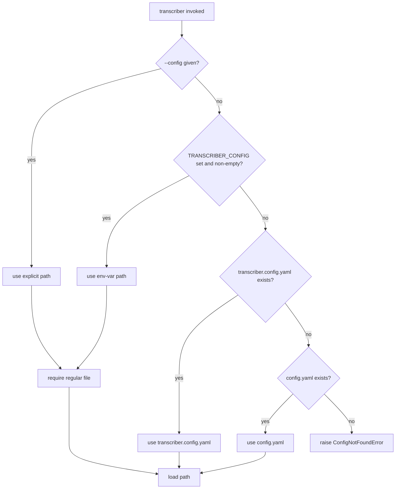

# Configuration model

Configuration is loaded into a single validated dataclass model. Both `.json` and `.yaml`/`.yml` map to the identical `Config` model, selected by file extension at load time.

Secrets are **never stored in the model**. The config references secrets by environment-variable **name only** (for example `telegram.bot_token_env` or `openrouter.api_key_env`); the actual value is resolved at *use* time via `resolve_env`. That means config files contain no inline credentials, and S3 auth uses a named AWS profile rather than embedded keys.

## Dataclass model

The top-level model is:

- `recordings_dir` — path to the directory scanned for `.mp4` recordings.
- `stages` — the `Stages` dataclass (`slides: SlidesStage`, `s3_sync: bool`).
- `transcribe` — `Transcribe(model_id, diarize, segment_seconds, overlap_seconds)`. Defaults are `model_id="microsoft/mai-transcribe-2"`, `diarize=True`, `segment_seconds=480`, `overlap_seconds=5`; `model_id` is an OpenRouter speech-to-text slug.
- `summary` — `Summary(language, sections, backend)`. `backend` defaults to `"agno"`.
- `agent` — `Agent(output_file, cli, extra_args)`. Only `output_file` (templated with `{basename}`) is still used; `cli` defaults to `None` and `extra_args` defaults to `[]` and both are legacy ignored fields kept only so old host configs carrying them continue to load.
- `notion` — `Notion(server, parent_page_id, insert, token_env)`. `token_env` is `Optional[str]` defaulting to `None`.
- `telegram` — `Telegram(bot_token_env, default_chat_id, routing, topic_descriptions, enabled)`. `topic_descriptions` defaults to `{}` and `enabled` defaults to `True`.
- `timeouts` — `Timeouts(...)` per-stage timeout block.
- `s3` — optional `S3(bucket, profile)`, defaults to `None`.
- `openrouter` — optional in the dataclass declaration (`Optional[OpenRouter]`, defaults to `None`) but required at load (`api_key_env, base_url, slides_model, summary_model, max_slides`).
- `debug` — optional boolean, defaults `False`, keeps intermediate artifacts after a successful run.

## Nested stages.slides

`Stages.slides` is a nested dataclass (`SlidesStage`) with `enabled: bool` and `backend: str = "openrouter"`. The legacy bare-boolean form (`slides: true`) is **not accepted** and raises `ConfigError` at load. Slides backend selection is constrained to `"openrouter"` (the only slides backend), validated in `_from_dict` against `SLIDES_BACKENDS`. Omitting `backend` falls back to the dataclass default `"openrouter"`.

## Mandatory openrouter block

The `openrouter` block is now **unconditionally required** at config load. It is the transcription backend (OpenRouter speech-to-text) in addition to the existing slides and `agno` triggers, so every config without an `openrouter` section raises `ConfigError`. Representative validation:

- missing `openrouter` raises `"'openrouter' section is required: it is the transcription backend (OpenRouter STT), and is also required when slides are enabled (stages.slides.enabled) or summary.backend == 'agno'"`.

The shared `openrouter` block carries **one block, two per-stage models**:

- `slides_model` — used by the `openrouter` slides backend (default `google/gemini-2.5-flash`).
- `summary_model` — used by the `agno` summarize backend (default `google/gemini-2.5-pro`).

Other `OpenRouter` fields:

- `api_key_env` — required env-var name for the OpenRouter key.
- `base_url` — defaults to `https://openrouter.ai/api/v1` when omitted.
- `max_slides` — optional deterministic slide-count ceiling for the `openrouter` slides backend; defaults to `60` when unset. An over-ceiling deck hard-fails before any image is sent (cost guard).

See [backend selection](./backend-selection.md) for how these models are used.

## Backend selectors

Two stage backends are selected as pure functions of config and validated at load:

- `describe_slides` → `config.stages.slides.backend`, only `"openrouter"`.
- `summarize` → `config.summary.backend`, `"agno"` (the only summarize backend, and the default).

`summary.language` must be `"en"` or `"original"`; invalid values raise `ConfigError`.

Notion token requirement is backend-specific:

- `notion.token_env` is required when `summary.backend == "agno"` (engine publishes via Notion REST).

## Notion / Telegram / S3 fields

- `Notion` — `server`, `parent_page_id`, `insert` (for example `"subpage"`), and optional `token_env` (env-var name).
- `Telegram` — `bot_token_env`, `default_chat_id`, `routing` (topic → chat id mapping), plus:
  - `topic_descriptions: dict[str, str]` — optional human-readable description per routing topic, used to steer the summary-partition (routing) model call. Keys should match `routing` keys; a topic without a description falls back to its bare label. Topics present here but absent from `routing` are ignored for routing. Defaults to `{}`.
  - `enabled: bool` — when `False`, the Telegram dissemination stage is skipped entirely (no digest is sent, and the bot-token env var is not required at pre-flight). Defaults to `True` so existing configs behave as before. Mirrors the gating of the S3 stage (`stages.s3_sync` plus `s3.is_enabled`).
- `S3` — optional `bucket` + `profile` (named AWS profile, not inline credentials). The stage runs only when both `stages.s3_sync` is true and `config.s3 is not None`.

## Timeouts

`Timeouts` provides per-stage timeouts; any omitted field falls back to `DEFAULT_TIMEOUT_SECONDS` (900s):

- `ffmpeg`, `scenedetect`, `slides`, `transcribe`, `s3` default to `900`.
- `summarize` is `Optional[int]` defaulting to `None`; `None` falls back to `DEFAULT_TIMEOUT_SECONDS` at use time via the summarize backend's timeout helper.

The legacy `elevenlabs` timeout key is silently dropped during load so old host configs still load; its value is ignored because the transcribe stage timeout is now `transcribe`.

## Secrets-by-env-name rule

Every secret reference in config is an environment-variable **name string**, not a value:

- `openrouter.api_key_env`
- `telegram.bot_token_env`
- `notion.token_env`

The model stores these names; `resolve_env(var_name)` reads `os.environ` at use time and raises `MissingEnvVarError` if the variable is unset. This keeps secrets out of config files and out of the in-memory `Config` object. See [pre-flight and idempotency](../operations/pre-flight-and-idempotency.md) for which names are required for a given config.

## Loader behavior

`load(path)` accepts `str | Path`, parses by extension (`.json` → `json.loads`, `.yaml`/`.yml` → `yaml.safe_load`), validates the root is a mapping, then builds a `Config` through `_from_dict`. Field building is unified via `_build_section`, which applies dataclass defaults for omitted optional fields and raises `ConfigError` for missing required fields. Unsupported extensions and non-mapping roots raise `ConfigError`. The `timeouts` section itself is optional; when omitted every field takes its default.

## Validation rules that raise ConfigError

- `stages.slides` must be a mapping `{enabled, backend}`; legacy bare bool rejected.
- `slides.backend` must be `"openrouter"`.
- `summary.backend` must be `"agno"`.
- `summary.language` must be `"en"` or `"original"`.
- `openrouter` section is required (unconditionally).
- `notion.token_env` required when `summary.backend == "agno"`.
- `debug` must be a boolean if present.
- Any missing required field or non-mapping section raises `ConfigError`.

Missing environment variables are **not** caught at config load. They surface at use time as `MissingEnvVarError` from `resolve_env`.

## Config discovery

Which file is handed to `load` is decided by `resolve_config_path(cli_config, env, cwd)` in `transcriber/__main__.py`, a pure function of its arguments (`env` and `cwd` are injected for testability). Precedence is strict:

1. Explicit `--config PATH` — authoritative. Must be a regular file, checked by `_require_regular_file` (uses `path.is_file()`); a missing path or directory raises `ConfigNotFoundError` with no fallback to candidates.
2. `TRANSCRIBER_CONFIG` — when set and non-empty after stripping whitespace, authoritative and checked the same way. Empty or whitespace-only is treated as unset and falls through.
3. First existing working-directory candidate: `transcriber.config.yaml`, then `config.yaml`. When both exist the first wins and a shadow notice is logged.
4. Otherwise raise `ConfigNotFoundError` naming all four sources (`--config`, `TRANSCRIBER_CONFIG`, `transcriber.config.yaml`, `config.yaml`).

Relative `--config` and `TRANSCRIBER_CONFIG` values are anchored against the injected `cwd` by `_anchor` (`path if path.is_absolute() else cwd / path`), not the process working directory, and every returned path is anchored consistently with the candidate branch. `ConfigNotFoundError` is defined in `transcriber/config.py` as a subclass of both `ConfigError` and `FileNotFoundError`, so the CLI's existing config-error path (exit code 2) catches it while programmatic callers can treat it as a missing-file condition.



Config discovery flow: authoritative CLI and env-var sources never fall back, candidates are tried in order.

The resolved path is logged (`using config:`) on every run and surfaced in `--dry-run` and `check` output; only the path is printed, never secrets. The `check` subparser declares `--config` with `argparse.SUPPRESS` so `transcriber --config X check` is not clobbered by a subparser default. See the [quickstart](../quickstart.md) for running with `--config` versus discovery.

## Packaging and host migration

`agno` (plus `openai`) is a core dependency: it lives in `[project.dependencies]` because `summarize` always runs on the `agno` backend. The `[project.optional-dependencies] agno = []` entry is retained as a deprecated no-op so existing host dependency strings `transcriber[agno]` keep resolving during the migration window; it will be dropped once all hosts drop `[agno]`.

Host migration shape (per host, executed outside the engine repo):

- Repoint `[tool.uv.sources]` from a local path/submodule (`transcriber = { path = "transcriber" }`) to a git ref, declare plain `transcriber` (not `transcriber[agno]`), remove the `./transcriber` submodule and `.gitmodules` entry, delete the per-host `transcribe.py` wrapper (its only job was injecting a `--config` default now subsumed by auto-discovery), then re-lock and verify with `--dry-run` and `check`.
- Run from the host root: relative paths in config (notably `recordings_dir`) resolve against the current working directory, and discovery looks for `transcriber.config.yaml` then `config.yaml` there. Use `--config` or `TRANSCRIBER_CONFIG` when invoking from elsewhere.

## Representative example configs

### acme — full setup (openrouter slides + agno summarize)

Annotated excerpts:

```yaml
recordings_dir: ./recordings

stages:
  slides:
    enabled: true
    backend: openrouter
  s3_sync: true

transcribe:
  model_id: microsoft/mai-transcribe-2
  diarize: true
  segment_seconds: 480
  overlap_seconds: 5

summary:
  language: original
  sections:
    - overview
    - key_points
    - action_items
  backend: agno

agent:
  output_file: "{basename}.md"

openrouter:
  api_key_env: OPENROUTER_API_KEY
  slides_model: google/gemini-2.5-flash
  summary_model: google/gemini-2.5-pro

notion:
  server: notion-acme
  parent_page_id: "REPLACE_WITH_PARENT_PAGE_ID"
  insert: subpage
  token_env: NOTION_API_KEY

telegram:
  bot_token_env: ACME_BOT_TOKEN
  default_chat_id: "REPLACE_WITH_DEFAULT_CHAT_ID"
  routing:
    topic-a: "REPLACE_WITH_TOPIC_A_CHAT_ID"
    topic-b: "REPLACE_WITH_TOPIC_B_CHAT_ID"

s3:
  bucket: "s3://acme-recordings/recordings/"
  profile: acme
```

This is the primary cost-saving combination: slides on `openrouter`, summarize on `agno` (OpenRouter model + direct Notion REST publish), with S3 sync and topic-routed Telegram.

### example — simpler setup (openrouter slides + agno summarize)

Annotated excerpts:

```yaml
recordings_dir: ./recordings

stages:
  slides:
    enabled: true
    backend: openrouter
  s3_sync: false

transcribe:
  model_id: microsoft/mai-transcribe-2
  diarize: true
  segment_seconds: 480
  overlap_seconds: 5

summary:
  language: en
  sections:
    - overview
    - key_points
    - action_items
  backend: agno

agent:
  output_file: "{basename}.md"

openrouter:
  api_key_env: OPENROUTER_API_KEY
  slides_model: google/gemini-2.5-flash
  summary_model: google/gemini-2.5-pro

notion:
  server: notion-example
  parent_page_id: "REPLACE_WITH_PARENT_PAGE_ID"
  insert: subpage
  token_env: NOTION_API_KEY

telegram:
  bot_token_env: TELEGRAM_BOT_TOKEN
  default_chat_id: "REPLACE_WITH_DEFAULT_CHAT_ID"
  routing: {}
```

This illustrates the other common backend combination: slides on `openrouter`, summarize on the `agno` backend, no S3 sync, single-chat Telegram, and `notion.token_env` present because summary runs on `agno`.
