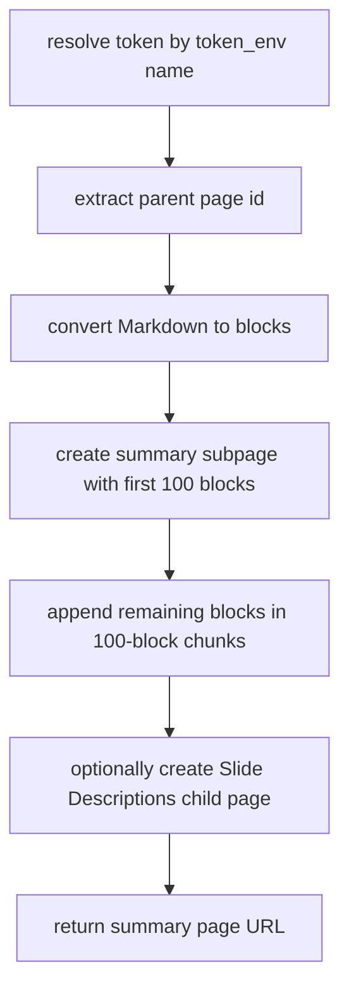

# Integration — Notion Direct REST Publish

The engine publishes every meeting summary to a Notion subpage with a single,
deterministic mechanism: direct calls to the Notion REST API from
`transcriber.backends.notion_publish.publish_to_notion`. There is no MCP
server, no `npx` subprocess, and no model tool-calling on the publish path.

The only summarize backend is `agno` (`summary.backend == "agno"`). The
`agno` backend produces the summary text with direct OpenRouter chat-completions
calls and then the engine publishes the subpage via REST. A summarize run must
publish to Notion or fail the stage.

## Why direct REST

The project intent is that summarize always publishes to Notion. An earlier
model-driven MCP plan was abandoned because the official Notion MCP server's
tool schemas (`oneOf`/`anyOf`/`$ref`) break tool-calling on Gemini/Mistral over
OpenRouter — the model returns an empty `null` completion with zero tool calls.
The engine therefore publishes deterministically with plain HTTPS requests.

The `transcriber.backends.notion_mcp` helper module remains in the tree but is
not imported on the summarize or publish path and plays no role in creating
pages.

## Config fields

Notion configuration lives in the `notion` block, modeled by
`transcriber.config.Notion`:

| Field | Type | Purpose |
|---|---|---|
| `server` | `str` | Notion server identifier (conceptual; used for logging/dry-run display). |
| `parent_page_id` | `str` | The parent under which the summary subpage is created. Accepts a bare 32-hex id, an already-hyphenated UUID, or a full Notion URL containing the id. |
| `insert` | `str` | Insertion mode (e.g. `"subpage"`). |
| `token_env` | `Optional[str]` | **Env-var name only** for the Notion API token. The secret value is never stored in the config model; it is resolved at use time via `transcriber.config.resolve_env`. Required when `summary.backend == "agno"`. |

Config validation enforces the dependency: `summary.backend == "agno"` without
`notion.token_env` raises `ConfigError` at load time.

## Entry point

`publish_to_notion(config, title, summary_markdown, *, slides_markdown=None, timeout=DEFAULT_NOTION_TIMEOUT)`
creates a new Notion subpage under `notion.parent_page_id` titled with the
recording basename (`title`), populated with the summary blocks. It returns the
**summary page URL**.

When `slides_markdown` is a non-empty block of cleaned slide descriptions, a
child page titled `SLIDES_SUBPAGE_TITLE` (`"Slide Descriptions"`) is created
**under the summary page** with the slide blocks, so the summary page stays
readable and the (often long) slide detail lives one click away.
`None`/empty/whitespace means no slides child page is created, and
`slides_markdown` must already be reader-facing markers-stripped text — the
publish function does not strip markers itself.



The diagram shows the engine-driven REST publish sequence for one summary.

## What it does

1. **Extract the parent page id** from `notion.parent_page_id`. `extract_page_id`
   accepts a bare 32-hex id, an already-hyphenated UUID, or a full Notion URL
   with the id embedded, and returns a hyphenated lower-case page id. Empty
   input or input with no extractable id raises `SummarizeError`.

2. **Convert Markdown to Notion blocks**, losing nothing. `markdown_to_blocks`
   is line-oriented (matching the shape of the produced summaries):
   - `#`/`##`/`###` → `heading_1`/`heading_2`/`heading_3` (Notion has no
     heading_4+, so deeper headings clamp to `heading_3`).
   - `-`/`*`/`+` → `bulleted_list_item`.
   - `1.`/etc. → `numbered_list_item`.
   - `>` → `quote`.
   - ```` ``` ```` fenced blocks → a single `code` block (content verbatim,
     language `plain text`).
   - Blank lines → skipped (Notion spaces blocks itself).
   - Anything else → `paragraph` (nothing is dropped).

   Inline markers (`**bold**` etc.) are kept as literal text so no characters
   are lost; the converter intentionally does not strip them. Long text is
   chunked into multiple rich-text objects to respect Notion's 2000-char-per-text-object cap.

3. **Create the subpage** under the parent with up to the first 100 blocks, then
   append the remainder in `<=100`-block chunks (`_MAX_CHILDREN_PER_REQUEST = 100`).
   Notion caps children per request at 100.

4. **Optional slides child page** under the just-created summary page, titled
   `"Slide Descriptions"`, holding the slide blocks. If the summary page is
   created but the slides child page then fails, the whole call raises; the
   caller must not record a successful publish, so a retry re-creates both
   (a narrow duplicate-summary-page window, unchanged in risk from the
   single-page design).

### Requests, version, and errors

Each REST call sends `Authorization: Bearer <token>` with
`Notion-Version: "2022-06-28"` and a JSON body. Failures raise `SummarizeError`
so the summarize stage fails (retryable): HTTP errors carry only a short
non-sensitive context (method, endpoint tail, status, truncated 300-char body
snippet), socket timeouts (`TimeoutError`, including `URLError` wrapping a
timeout) are wrapped as timeout `SummarizeError`s, and an empty block list
fails before any request.

### Secrets and log hygiene

The Notion token is resolved by env-var **name** (`notion.token_env`) at use
time via `resolve_env` and is **never logged**. Error messages and info logs
carry only the title, block counts, URLs, and truncated response snippets —
never the token.

### Timeouts

`DEFAULT_NOTION_TIMEOUT = 60.0` is the bounded per-request socket timeout.
Without it, `urlopen` blocks indefinitely; because the publish runs inside
`asyncio.to_thread`, cancelling the outer `wait_for` cannot stop a stuck urllib
worker, so `timeouts.summarize` would not be a hard bound for the Notion phase.
A bounded socket timeout makes each request fail fast instead. The agno backend
further caps the per-request timeout by the summarize-stage budget via
`_notion_request_timeout` (`min(summarize_timeout, DEFAULT_NOTION_TIMEOUT)`).

## Idempotency / duplicate-page guard

The agno backend persists the local artifacts (`<name>.md`,
`<name>.telegram.md`, optional `<name>.slides-clean.md`) **before** publishing
to Notion. It then writes a sidecar `<name>.notion_published.json` (containing
`{"url": page_url}`) after a successful publish. If that sidecar already exists
(crash between publish and manifest mark), the publish is skipped to avoid
creating a duplicate subpage.

At the orchestrator level, summarize and Notion are one atomic run: after
`backend.summarize(...)` returns, the per-recording state manifest marks both
`summarize` and `notion` complete together. Already-completed stages are skipped
on retry, so no duplicate Notion pages, Telegram sends, or re-syncs occur.

## Orchestration and pre-flight

The orchestrator in `transcriber.__main__` treats backend selection as a pure
function of config. For summarize, `get_summarize_backend(config)` returns
`AgnoSummarizeBackend()` for `"agno"` by lazily importing that class; there is
no `agy` summarize branch and no silent cross-backend fallback — an unknown
value raises.

Pre-flight (`transcriber check` / `preflight_check`) verifies the env vars
referenced by name are actually set — including `notion.token_env` when
`summary.backend == "agno"` and `token_env` is configured. It resolves each name
via `resolve_env`; a missing (unset) variable is reported as a pre-flight
problem (`missing required environment variable`). Secret values are never read
beyond this presence check and never logged.

The dry-run plan surfaces the selected backend per stage, including
`summarize+notion [<backend>]` and the Notion parent display.

## Focused tests

- `tests/test_notion_publish.py` — covers `extract_page_id` (hyphenated UUID,
  bare hex, Notion URL, uppercase lowered, empty/no-id raises),
  `markdown_to_blocks` (heading mapping including deeper-heading clamping to
  `heading_3`, bullets/numbers, quote/code/paragraph, blank-line skipping,
  inline markers kept verbatim, long-paragraph chunking), bounded per-request
  timeout passed to `urlopen`, socket `TimeoutError` wrapped as
  `SummarizeError`, the default bounded timeout, and the slides child subpage
  creation (parented under the summary page, titled `"Slide Descriptions"`,
  absent when slides are empty/whitespace).

## Related

- [Pre-flight and idempotency](../operations/pre-flight-and-idempotency.md) — env-var and binary checks plus manifest-based retry skips.
- [Summarize + publish workflow](../workflows/summarize-publish.md) — the end-to-end summarize stage including Notion publish.
