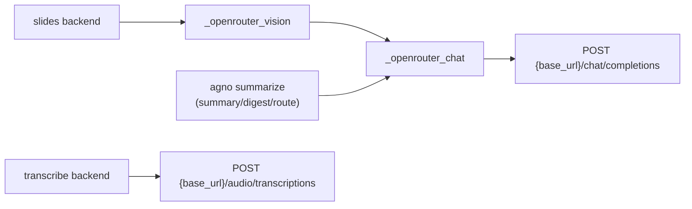

# Integration — OpenRouter HTTP Seam

The transcriber depends on OpenRouter unconditionally: it is the speech-to-text backend for the `transcribe` stage, and it also backs the `describe_slides` stage (vision) and the `agno` summarize path (summary, digest, and routing calls). There is no second paid API provider.

> Related pages: [Config Model](../concepts/config-model.md), [Slides Description](../workflows/slides-description.md), [Summarize Publish](../workflows/summarize-publish.md).

## Scope

OpenRouter shows up in three stages, served by two transcriber-owned HTTP seams:

- **`transcriber.backends.transcribe_openrouter`** — OpenAI-format `/audio/transcriptions` for diarized STT (the `transcribe` stage).
- **`transcriber.backends.openrouter`** — shared `/chat/completions` helpers used by both the slides `openrouter` backend and the `agno` summarize backend:
  - `_openrouter_chat` — general-purpose text helper. Returns `choices[0].message.content` and raises a caller-supplied error type.
  - `_openrouter_vision` — thin wrapper around `_openrouter_chat` that raises `SlideDescribeError`, used by the slides backend.
- **`transcriber.backends.slides.OpenRouterSlidesBackend`** — one OpenRouter vision call per slide, via `_openrouter_vision`.

The `agno` summarize backend also goes through the shared helper: it calls `_openrouter_chat` directly with `error_cls=SummarizeError`. The backend keeps the name `agno` for config compatibility, but it no longer drives an Agno agent or SDK client.

## Why OpenRouter is unconditionally required

The loader treats `openrouter` as a top-level, required section: although `Config.openrouter` is typed `Optional[OpenRouter]`, `_from_dict` unconditionally requires the mapping and hard-fails with a `ConfigError` when it is absent. The requirement is not gated on slides or summarize settings — it is required because `openrouter` is the transcription backend, in addition to the slides and summarize triggers.

A host config missing `openrouter` cannot start the orchestrator.

## Configuration model

The `openrouter` section is described by `transcriber.config.OpenRouter`:

- `api_key_env` (required) — env-var **name** for the API key, not the key itself.
- `base_url` (default `https://openrouter.ai/api/v1`) — the OpenAI-format root URL both seams use.
- `slides_model` (default `google/gemini-2.5-flash`) — the vision model used by `describe_slides`.
- `summary_model` (default `google/gemini-2.5-pro`) — the model used by the `agno` summarize path (summary, digest, and routing calls).
- `max_slides` (default `60`) — deterministic slide-count ceiling for the `openrouter` slides backend.

The `Transcribe` stage block is separate from `OpenRouter`:

- `transcribe.model_id` (default `microsoft/mai-transcribe-2`) — the STT model slug sent to `/audio/transcriptions`.
- `transcribe.diarize`, `transcribe.segment_seconds`, `transcribe.overlap_seconds` — chunking and diarization knobs.

This separation matters: the STT model and the vision/summary models are selected by different config fields and belong to different stages. Do not conflate `transcribe.model_id` with `openrouter.slides_model` or `openrouter.summary_model`.

## API key handling

Secrets are never stored in the config model. The config references secrets by environment-variable **name only**, and the actual value is resolved at **use time** via `transcriber.config.resolve_env`.

`resolve_env` reads `os.environ.get(var_name)` and raises `MissingEnvVarError` when the variable is absent, with a message naming the variable. It is the single secret-resolution seam used by the transcription, slides, summarize, and Notion paths.

At the HTTP seams, the key is resolved immediately before building the request:

- `transcriber.backends.transcribe_openrouter._openrouter_transcribe` resolves `config.openrouter.api_key_env` and places it in `Authorization: Bearer <key>`.
- `transcriber.backends.openrouter._openrouter_chat` (and therefore `_openrouter_vision` and the summarize path) does the same for the chat-completions path.

Both seams then attach the public, non-secret OpenRouter attribution headers (`HTTP-Referer`, `X-Title`) before posting.

The log-hygiene contract is strict and documented in the module docstrings: the API key, request headers, and base64 audio/image payloads are **never logged or embedded in exceptions**. Errors carry only the HTTP status and a short truncated body snippet.

## HTTP seams

### Shared chat seam (`/chat/completions`)

```python
def _openrouter_chat(config, messages, model, *, timeout, error_cls=SlideDescribeError, missing_config_message=None) -> str
def _openrouter_vision(config, messages, model, *, timeout) -> str
```

`_openrouter_chat` is the single HTTP seam for every OpenRouter chat-completions call in the engine. It:

- Posts to `POST {base_url}/chat/completions` with the caller-supplied `messages` and `model`, honoring the per-request `timeout`.
- Sends `Authorization: Bearer <key>` plus `HTTP-Referer`, `X-Title`, and `Content-Type: application/json`.
- Reads `choices[0].message.content` straight from the JSON response. This is deliberate: the Agno client's `get_content_as_string()` truncated reasoning-model output (models returning a separate `reasoning` channel alongside `content`), so the engine avoids SDK accessors entirely.
- Retries `429`, `500`, `502`, `503`, `504` with bounded exponential backoff (up to `MAX_ATTEMPTS = 4` total tries including the first), then raises the caller's error type. Transport errors (`httpx.HTTPError`) are retried within the same cap, logging only the exception type name.
- On a non-2xx after retries, malformed JSON, or a missing `choices[0].message.content`, raises the caller's error type (`SlideDescribeError` for slides, `SummarizeError` for summarize).

`_openrouter_vision` has identical behavior with a fixed contract: it forwards to `_openrouter_chat` with `error_cls=SlideDescribeError` and a slides-specific missing-config message. It exists as a named seam so the slides backend and its tests monkeypatch one stable symbol.

When `config.openrouter` is `None`, `_openrouter_chat` raises the caller's error type (a hard failure, never a silent fallback). The summarize caller supplies its own message (`_summarize_openrouter`); the vision wrapper supplies the slides message.



### Transcription seam (`/audio/transcriptions`)

`transcriber.backends.transcribe_openrouter._openrouter_transcribe` transcribes exactly one audio file and returns one `TranscriptChunk`. It mirrors the retry, backoff, `_snippet`, and log-hygiene scaffolding of the chat seam, but posts a **JSON base64** body rather than OpenAI multipart.

Key behaviors:

- One POST per audio part to `POST {base_url}/audio/transcriptions`.
- The audio is read as bytes and base64-encoded as `input_audio.data` with `format: "mp3"` — a raw base64 payload, **not** a `data:` URI.
- When `diarize` is true, it requests `verbose_json` and merges a per-model provider diarization block for `microsoft/mai-transcribe-2` (the only model with a registered toggle, matched by substring so a bare `mai-transcribe-2` also matches). An unknown model sends `verbose_json` without a provider toggle and relies on native diarization, failing cleanly on a 400 if unsupported.
- Language is derived from `summary.language`: only `"en"` is forwarded as the STT `language` hint; any other value (notably `"original"`) is omitted for auto-detection.
- Retry behavior:
  - `429`, `500`, `502`, `503`, `504` are retried with bounded exponential backoff (up to `MAX_ATTEMPTS = 4` total tries including the first).
  - A `400` is **not** retryable: it fails immediately with no silent fallback.
  - Transport errors (`httpx.HTTPError`) are also retried within the cap.
  - Any other non-2xx after retries raises `TranscribeError`.
- Response parsing is defensive: `_parse_response` prefers `segments`, falls back to `words` for per-speaker turns, and degrades to flat `raw_text` with a warning when diarization yields no parseable shape. It never silently crashes. `usage.cost` is captured per chunk when present.

The manifest in `transcribe_recording` makes this seam partially idempotent: completed parts are read from `segments.json` and never re-issued, so a retry after a failure does not re-pay already-completed segments.

## Per-stage model selection

Model selection is a pure function of config, and each stage picks from a different field:

- **`describe_slides`** always uses the `openrouter` vision backend. Config load validates that `stages.slides.backend == "openrouter"` (the only allowed value); the orchestrator's slides-backend selector returns `OpenRouterSlidesBackend()` and raises on any other value rather than silently falling back. The model sent per slide is `config.openrouter.slides_model`.
- **`transcribe`** always uses the OpenRouter STT seam. The model sent per audio part is `config.transcribe.model_id`.
- **`summarize`** uses the `agno` backend (the only summarize backend). The backend issues direct OpenRouter chat-completions calls via `_openrouter_chat` using `config.openrouter.summary_model` for the summary, digest, and Telegram routing calls. The Agno SDK is not involved; selection is still `get_summarize_backend(config)` with no silent cross-backend fallback.

The allowed backend selectors are constrained at config load:

- `SLIDES_BACKENDS = ("openrouter",)`
- `SUMMARY_BACKENDS = ("agno",)`

An unknown value raises `ConfigError` at load time rather than falling back silently.

## Slides path specifics

The `describe_slides` backend issues **one OpenRouter vision call per slide**, each carrying a single downscaled JPEG and the `Timestamp: MM:SS - MM:SS` text part placed immediately before the `image_url` part.

Important invariants:

- The descriptor is **image-only**: it never receives the transcript. `transcript_text` is accepted only to satisfy the `SlidesBackend` protocol and is discarded. Transcript cross-referencing is the summarize stage's job.
- Empty semantics: an empty slide set returns `""` with **no** HTTP call; a valid empty/whitespace backend response contributes nothing. Placeholder and `[[SLIDE_EMPTY ...]]` marker outputs are kept verbatim in `<name>.slides.md` for debugging and stripped later for summary and Notion output only.
- Per-slide timestamps: unknown timing is passed as the literal `unknown`, never omitted.
- Downscale: each JPEG is downscaled to a bounded long edge (`MAX_IMAGE_LONG_EDGE = 1024`, re-encoded at quality 85) before base64. This is a size/cost control, not redaction.
- Deterministic ceiling: the slide-count bound (`MAX_SLIDES = 60`, overridable via `openrouter.max_slides`) and the whole-deck encoded-byte bound (`MAX_TOTAL_ENCODED_BYTES = 48 MiB` of base64) are enforced **before** any HTTP call. Over-ceiling decks hard-fail with `SlideDescribeError` (no chunking). The preflight encodes every slide once into a cache that the per-slide message builder reuses, so images are never re-encoded.

Log hygiene for the slides path is also strict: logs carry stage, model, slide-count, encoded bytes, and elapsed only — never the API key, headers, or image bytes.

## Summarize path specifics

The backend is still named `agno` for config compatibility, but it makes direct OpenRouter REST calls via `_openrouter_chat` for three prompts: the full summary, the short Telegram digest derived from that summary, and the Telegram routing partition. Each call reads `choices[0].message.content` directly so reasoning-model output is complete.

This design also drops the former Agno client's telemetry POST to `os-api.agno.com`.

Operational guards live in `summarize_agno`, not in the shared helper:

- Each model call runs under the summarize-stage timeout (`timeouts.summarize` when set, else `DEFAULT_TIMEOUT_SECONDS`); the blocking calls run in worker threads so the outer `asyncio.wait_for` bound can still cancel the run.
- Non-empty post-condition: an empty or absent `<name>.md` fails the stage (retryable).
- Atomicity: summarize plus Notion publish happen in a single run, so a Notion failure fails the whole `summarize` plus `notion` stage.
- Local artifacts (`<name>.md`, `<name>.telegram.md`) are written before publishing, and a `.notion_published.json` sidecar prevents a retry from creating a duplicate Notion page.

## Notion publishing is not part of the OpenRouter HTTP seam

The `agno` summarize backend produces the Markdown summary with an OpenRouter model, but the actual Notion publish is **engine-side**, not model-side. The engine publishes the subpage directly via the Notion REST API (`transcriber.backends.notion_publish.publish_to_notion`), with no MCP and no model tool-calling.

This split exists because the official Notion MCP's tool schemas break tool-calling on Gemini and Mistral models over OpenRouter (empty `null` completions, zero tool calls).

The Notion token is resolved at use time from `config.notion.token_env` and is never logged, mirroring the OpenRouter key handling.

## Retry, timeout, and partial-failure behavior

Timeouts are configured per-stage in `transcriber.config.Timeouts`, defaulting to `DEFAULT_TIMEOUT_SECONDS = 900`:

- `ffmpeg`, `scenedetect`, `slides`, `transcribe`, `s3` each have their own field.
- `summarize` is optional; `None` falls back to `DEFAULT_TIMEOUT_SECONDS` at use time (used by the `agno` backend). The Notion publish timeout is additionally bounded by that summarize budget.

The two OpenRouter seams share the same retry and backoff constants:

- `MAX_ATTEMPTS = 4`
- `_BACKOFF_BASE_SECONDS = 0.5`
- `_BACKOFF_CAP_SECONDS = 8.0`
- Retryable statuses: `429`, `500`, `502`, `503`, `504`

Failure isolation is orchestrated, not at the HTTP seam: a raised exception in one stage or recording is caught, logged, recorded in that recording's manifest, and the batch continues. Cleanup runs only on full success.

For the `transcribe` stage specifically, the `segments.json` manifest gives per-segment idempotency and a parameter guard: if the stored `segment_seconds` or `overlap_seconds` differ from the current config, the work dir is discarded and rechunked.

## Log hygiene and secrets

The integration enforces a consistent log-hygiene contract across both seams and the surrounding backends:

- The OpenRouter API key is resolved at use time from an env-var name and is never stored in the config model.
- The API key, request headers, and base64 payloads (audio or image) are never logged and never embedded in exceptions.
- Error messages carry only the HTTP status and a short truncated body snippet (bounded by `_SNIPPET_LEN = 200`, single-line collapsed).
- Transport exceptions are not logged with their request, because the request carries the headers and base64 payload; only the exception type name is logged.

## Files that matter

- `transcriber/config.py` — `OpenRouter`, `Transcribe`, `Timeouts`, `Config`, `resolve_env`, and the unconditional `openrouter` requirement.
- `transcriber/backends/transcribe_openrouter.py` — STT seam, chunker, stitch, reconcile, render, manifest, and stage entry.
- `transcriber/backends/openrouter.py` — shared `_openrouter_chat` and `_openrouter_vision` chat-completions helpers.
- `transcriber/backends/slides.py` — `OpenRouterSlidesBackend`, slide-input helper, downscaling and encoding, ceiling checks, placeholder recognition.
- `transcriber/backends/summarize.py` and `transcriber/backends/summarize_agno.py` — summarize backend selection and the `agno` path (direct OpenRouter calls plus engine-side publish).
- `transcriber/backends/errors.py` — `TranscribeError`, `SlideDescribeError`, `SummarizeError`.
- `transcriber/backends/interfaces.py` — `SlidesBackend`, `SummarizeBackend`, `SlideInput`, `SummaryResult`.
- `transcriber/backends/notion_publish.py` — engine-side Notion REST publish for the `agno` backend (no MCP, no model tool-calling); related but not part of the OpenRouter HTTP seam.
- `transcriber/backends/notion_mcp.py` — official Notion MCP server launch helpers; unused by the current `agno` publish path.

The orchestrator entry point that wires these together is `transcriber/__main__.py`.
