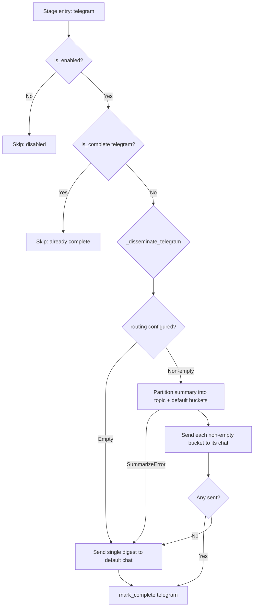

# Integration — Telegram Dissemination and Topic Routing

The transcriber disseminates meeting summaries to Telegram chats through the Bot HTTP API (`sendMessage`). The integration lives in `transcriber/publish/telegram.py` and is orchestrated from `transcriber/__main__.py` as a gated stage in the per-recording pipeline.

Related design context: [Configuration model](../concepts/config-model.md), [Pre-flight and idempotency](../operations/pre-flight-and-idempotency.md), [Summarize & Publish workflow](../workflows/summarize-publish.md).

## Enabled gate

Whether the stage runs at all is decided by `is_enabled(config)` in `transcriber/publish/telegram.py`:

- It returns `config.telegram.enabled`, which defaults to `True` so existing configs behave exactly as before.
- This mirrors the S3 stage's `transcriber.publish.s3.is_enabled` gating (`stages.s3_sync` plus `s3.is_enabled`).
- The orchestrator checks the gate before anything else: when disabled it logs `telegram: disabled, skipping` and never touches the manifest, the digest files, or the network.
- The dry-run plan honors the same gate: `telegram` appears in the stage list and the `Telegram chats:` destination line (default chat plus every deduplicated `routing` value) only when enabled; otherwise the plan prints `Telegram: disabled`.

## Pre-flight token requirement

`transcriber check` only requires the bot-token variable when the stage will run. `_required_env_vars` appends `config.telegram.bot_token_env` conditionally on `telegram.is_enabled(config)`, then `preflight_check` reports `missing required environment variable: '<name>'` when `resolve_env` fails. When `telegram.enabled` is `False`, the token variable is not required and no secret value is ever read during pre-flight.

## Orchestration and manifest gating

Telegram is a late stage in `_process_one` (after `summarize`/`notion`, before `s3-sync` and `cleanup`). The sequence for each recording is:

1. If `is_enabled` is `False`, skip the stage entirely.
2. Else if `state.is_complete("telegram")` on the `<name>.transcriber_state.json` manifest, log `already complete, skipping`.
3. Else log `sending`, run `_disseminate_telegram(mp4, config, name)`, then call `state.mark_complete("telegram")`, which persists the manifest immediately.

Because the mark happens only after a successful send, a crash or HTTP failure leaves the stage incomplete so the next retry re-sends, while a successful run is never duplicated. A per-recording exception is caught by `_process_one`, logged with the stage name, and recorded as a failed `RecordingOutcome` with `failed_stage="telegram"` so the batch continues to the next recording.



## What gets sent: single digest versus routed partition

`_disseminate_telegram` has two modes selected by `config.telegram.routing`.

### Single-digest mode (no routing)

When `routing` is empty, the orchestrator sends one message to the default chat:

- `_single_digest_text` prefers the concise `<name>.telegram.md` digest written by the summarize backend.
- The digest path is derived by `agent.digest_path_for(summary_file)` as `<name>.telegram.md`.
- Only when that file is missing or whitespace-only does it log `digest missing/empty, sending full summary` and send the full `<name>.md` summary instead.

The backend keeps this invariant: it writes the digest when non-empty and deletes any stale `<name>.telegram.md` when the digest comes back empty, so a reprocess never disseminates an outdated digest.

### Routed mode (topic partition)

When `routing` is non-empty, the orchestrator partitions the **full summary** (richer than the short digest) into one digest per topic plus a default remainder, using a single model call (Option B):

1. `build_agno_route_prompt(config, summary_text)` lists every configured topic (with its `topic_descriptions` text when present) plus the reserved `__default__` key, and demands strict JSON keyed by exactly that set. Each value must be a short Telegram-style digest (title plus decisions/actions, well under 1500 characters) or `""` when the bucket has no relevant content.
2. `build_routed_digests` runs the call under the summarize-stage timeout and parses the reply with `_parse_route_json`, which strips a surrounding ```` ``` ```` / ```` ```json ```` fence, fills missing buckets with `""`, drops invented extra keys, coerces non-string values to `""`, and strips whitespace. Only a non-JSON payload or a non-object JSON value raises `SummarizeError`.
3. For each configured topic in `routing` order, an empty bucket is logged (`topic ... empty, skipping`) and skipped with no file and no send. Each non-empty bucket is written to a per-topic file and sent with `publisher.send(text, topic=topic)`, which resolves to `routing[topic]`.
4. The `__default__` remainder bucket is written and sent with `topic=None`, which resolves to `default_chat_id`.
5. Per-topic files use `_routed_digest_path`: `<name>.telegram.<slug>.md`, where the topic label is slugified (`[^0-9A-Za-z_-]` becomes `-`, so `ECL2.0` becomes `ECL2-0`) and `default` is used for the remainder bucket. Empty buckets write no file.

Two fallbacks guarantee the notification is never dropped by routing:

- **Partition failure:** a `SummarizeError` (timeout, transport error, non-JSON, non-object) logs `routing partition failed (...); falling back to a single digest to the default chat` and sends `_single_digest_text` to the default chat.
- **All buckets empty:** when every bucket is `""`, it logs `all routed buckets empty; sending single digest to the default chat` and sends the single digest to the default chat.

## Chat routing

`resolve_chat_id(telegram, topic)` implements the routing rule:

- A non-empty `topic` present in `config.telegram.routing` resolves to the mapped chat id.
- `None`, an empty string, or an unmatched topic falls back to `config.telegram.default_chat_id`.

`TelegramPublisher.send(text, topic=None)` resolves the chat once per call, so every chunk of a multi-chunk message lands in the same chat. Single-digest sends and the default remainder bucket always use `topic=None` and therefore the default chat.

## Bot token resolution

The config model never stores a literal secret. The `Telegram` dataclass holds only the **name** of the environment variable (`telegram.bot_token_env`), plus `default_chat_id`, `routing`, optional `topic_descriptions`, and `enabled`.

At send time `TelegramPublisher._token()` resolves that name via `transcriber.config.resolve_env`. If the variable is unset, it raises `TelegramError` naming the missing variable and the `telegram.bot_token_env` source, with guidance to export it before publishing. No HTTP request is attempted in that case, and the stage is left incomplete so a retry can succeed once the environment is fixed.

## Markdown stripping

`sendMessage` is called **without** a `parse_mode`, so raw Markdown markers would render literally. Instead `send()` applies `strip_markdown` before chunking, so every transmitted chunk is clean plain text:

- `**bold**`, `__bold__`, `*italic*`, `_italic_` become inner text.
- `` `code` `` loses its backticks; fenced-code fences (```` ``` ````) are removed while content lines are kept verbatim.
- Leading `#` heading markers are removed; `> quote` markers are removed.
- `-` / `*` / `+` list bullets become a `•` glyph (U+2022), with indentation preserved.
- `[text](url)` becomes `text (url)` and `` becomes `alt (url)` (or just the URL when alt is empty), so link targets are not lost.
- Line structure is otherwise preserved.

There is intentionally no Telegram MarkdownV2 escaping: MarkdownV2 requires pervasive escaping and rejects unescaped specials, and Telegram has no heading or list formatting anyway.

## Message chunking

Telegram enforces a hard limit of 4096 characters per text message (`TELEGRAM_MAX_MESSAGE_CHARS`). `chunk_message(text, limit=4096)` splits the already-stripped text purely by character count into sequential chunks of at most `limit` characters. It raises `ValueError` for a non-positive limit, and an empty string yields a single empty chunk so at least one `sendMessage` call is made.

The publisher sends each chunk as a separate `POST https://api.telegram.org/bot<token>/sendMessage` with payload `{"chat_id": "...", "text": "..."}` and no `parse_mode` field. It returns one `httpx.Response` per chunk, all addressed to the same resolved chat.

## HTTP and client details

- Base URL `https://api.telegram.org`; per-message URL `https://api.telegram.org/bot<token>/sendMessage`; method `POST`.
- The publisher accepts an optional pre-configured `httpx.Client` (used by tests to inject a mock transport); when omitted it creates a client per `send` call.
- Any `httpx.HTTPError` (non-2xx via `raise_for_status`, network error, timeout) is surfaced as `TelegramError` naming the failing chat id and the underlying error. The stage is then not marked complete, so the retry re-sends.

## Configuration shape

```yaml
telegram:
  bot_token_env: "TELEGRAM_BOT_TOKEN"   # env-var NAME, not the token itself
  default_chat_id: "..."                # fallback chat for unmatched / no topic
  routing:                              # optional topic -> chat mapping
    engineering: "..."
    product: "..."
  topic_descriptions:                   # optional steering hints for the partition prompt
    engineering: "the platform team"
  enabled: true                         # default true; false skips the stage entirely
```

`bot_token_env`, `default_chat_id`, and `routing` are required at load; `topic_descriptions` defaults to `{}` and `enabled` defaults to `True`. Keys in `topic_descriptions` should match `routing` keys; entries without a matching `routing` key only steer classification text and never add buckets. The token value itself is resolved from the environment at use time, never stored in the config file.

## Failure behavior

- Disabled stage: no digest read, no partition call, no HTTP request, no manifest write.
- Missing bot-token env var: `TelegramError` naming the variable; no request attempted; recording marked failed at stage `telegram`.
- `sendMessage` HTTP failure: `TelegramError` naming the chat; stage not marked complete; recording marked failed at stage `telegram`.
- Partition-model failure or all-empty buckets: not a Telegram failure — falls back to the single digest to the default chat as described above.
- Failure isolation: one recording's Telegram exception is caught, logged with the stage name, recorded in that recording's outcome, and the batch continues.
