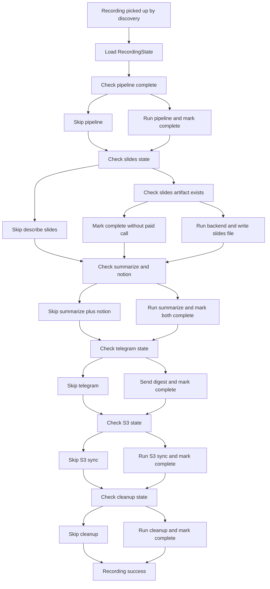
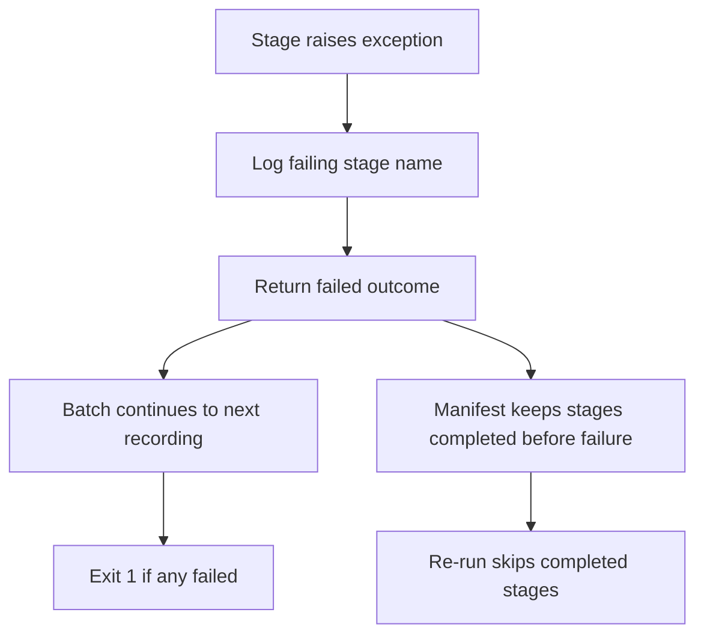

# Pre-flight checks and idempotent retries

The transcriber CLI (`transcriber/__main__.py`) has three related reliability surfaces that keep runs safe to retry: a **pre-flight check** that validates binaries and environment before any work, a **dry-run mode** that prints the execution plan without side effects, and a **per-recording state manifest** that makes re-runs skip already-complete stages. Together these mean a batch can be interrupted, re-run, or partially failed without duplicating paid/network calls, Notion pages, Telegram sends, or S3 syncs.

For the pipeline this orchestrates, see [OSS Companion Transcriber](../architecture/oss-companion-transcriber.md); for publishing destinations see [S3](../integrations/s3.md), [Telegram](../integrations/telegram.md), and [Quickstart](../quickstart.md).

## Pre-flight check (E2)

`preflight_check(config)` returns a list of human-readable problem strings (empty when all is well). It is called in two places: inside the `transcriber check` subcommand and at the start of a normal run, where a non-empty result short-circuits to exit code 1 before any stage runs.

### Required binaries

The always-required binary set is a single tuple:

```python
_ALWAYS_BINARIES = ("ffmpeg",)
```

`ffmpeg` is the only binary required on every run. Transcription runs over the OpenRouter HTTP seam rather than a legacy CLI, so there is no transcription CLI binary. `scenedetect` is added when slides are enabled, and `aws` is added when S3 sync is enabled.

The helper `_required_binaries(config)` builds the per-config list:

```python
def _required_binaries(config: Config) -> list[str]:
    required = list(_ALWAYS_BINARIES)          # ffmpeg
    if config.stages.slides.enabled:
        required.append("scenedetect")
    if s3_mod.is_enabled(config):
        required.append("aws")
    return required
```

Each binary is checked with `shutil.which`; a missing binary produces a problem like `missing required binary on PATH: 'ffmpeg'`.

### Required environment variables

`_required_env_vars(config)` returns the env-var names that must be set. Secrets are referenced by name only and resolved through `resolve_env` — the pre-flight check never reads secret values.

```python
def _required_env_vars(config: Config) -> list[str]:
    required = []
    if telegram_mod.is_enabled(config):
        required.append(config.telegram.bot_token_env)

    if config.openrouter is not None:
        required.append(config.openrouter.api_key_env)

    if config.summary.backend == "agno" and config.notion.token_env:
        required.append(config.notion.token_env)

    return required
```

The rules are:

- **Telegram bot token** — required only when the Telegram stage is enabled (`config.telegram.enabled`, default `True`). When `enabled: false` the stage is skipped entirely and the token env var is not required.
- **OpenRouter API key** — required whenever the `openrouter` config section is present, referenced via `config.openrouter.api_key_env`. Because transcription itself runs over the OpenRouter HTTP seam, the section is mandatory (see below), so in practice every valid run requires the key regardless of slides/summary backend selection.
- **Notion token** — required only when `summary.backend == "agno"` and `config.notion.token_env` is set. The `agno` summarize backend publishes to Notion via the engine's REST API call, so the engine-side Notion token env is required for that path. There is no separate `agy` summarize backend in the current codebase.

A missing variable produces a problem like `missing required environment variable: 'TG_TOKEN'`.

### Missing openrouter section fails fast

Because the `openrouter` block is mandatory (transcription runs over its HTTP seam), a config lacking the section is caught explicitly before any binaries or env vars are checked:

```python
if config.openrouter is None:
    problems.append(
        "missing required 'openrouter' config section: transcription runs "
        "over the OpenRouter API, so the block (and its api_key_env) is "
        "required for every run"
    )
```

### The `check` subcommand

`transcriber check [--config PATH]` runs the pre-flight check standalone. `_cmd_check` formats the selected backends per stage (`describe_slides backend='openrouter'` or `describe_slides: disabled`, plus `summarize backend='<backend>'`) and exits 0 when all required binaries and env vars are present, non-zero (1) otherwise.

```
transcriber check --config config.yaml   # exit 0 on pass, 1 on fail
```

Exit codes for the whole CLI:

- **0** — all recordings succeeded, or no new recordings, or dry-run completed.
- **1** — pre-flight check failed, or any recording failed in the batch.
- **2** — config loading failed.

## Dry-run (P1)

`--dry-run` prints the execution plan and exits without performing any side effects: no subprocesses, no agent runs, no publishing, no deletion, and no manifests written.

```
transcriber --config config.yaml --dry-run
```

Dry-run does **not** enforce the pre-flight check. It discovers new recordings (recordings whose summary `.md` does not yet exist), builds the plan from `_enabled_stage_names(config)`, and prints it via `print_plan`.

### Execution plan output

`print_plan` emits:

- An `Execution plan (dry-run):` header.
- Per recording: `recording: <name>.mp4` and `stages: <comma-separated stage tokens>`.
- Publishing destinations: Notion server/parent page id, Telegram chats (or `Telegram: disabled` when the Telegram stage is off), and S3 bucket/profile when enabled (or `S3: disabled`).
- When there are no new recordings: `no new recordings found in <recordings_dir>`.

### Dry-run stage tokens

`_enabled_stage_names(config)` returns the ordered token list that appears in the plan. The tokens are pinned and disambiguated as follows:

| Token | Present when | Notes |
|---|---|---|
| `audio-extract` | always | pipeline audio extraction |
| `scene-extract` | `stages.slides.enabled` | pipeline slide/scene extraction — **not** `slides` |
| `transcribe [openrouter:<model_id>]` | always | surfaces the OpenRouter backend + configured model |
| `describe-slides [<backend>]` | `stages.slides.enabled` | paid slides backend call — only when slides on |
| `summarize+notion [<backend>]` | always | surfaces the selected summarize backend (always `agno`) |
| `telegram` | Telegram stage enabled | gated on `config.telegram.enabled` |
| `s3-sync` | S3 sync enabled | gated S3 stage |

Ordering is fixed: `scene-extract` (when present) comes after `audio-extract` and before `transcribe`; `describe-slides` comes after `transcribe` and before `summarize+notion`.

#### Disambiguation: scene-extract vs describe-slides

These are distinct stages and must not be conflated in the plan:

- **`scene-extract`** — the deterministic pipeline stage that runs `scenedetect` to extract slide images. It is media-only and appears in the plan only when slides are enabled.
- **`describe-slides [<backend>]`** — the manifest-gated, paid/network stage that runs the configured slides backend (always `openrouter`) to produce `<name>.slides.md`. It appears only when slides are enabled.

Both appear in the plan only when `stages.slides.enabled` is true, and both are absent when slides are disabled.

#### Disambiguation: describe-slides vs summarize+notion

- **`describe-slides [<backend>]`** is conditional on slides being enabled. When slides are disabled the token is absent entirely.
- **`summarize+notion [<backend>]`** is always present in the plan, with the selected backend surfaced in the token (always `summarize+notion [agno]` since `agno` is the only summarize backend).

#### Transcribe token

The transcribe token always surfaces the OpenRouter backend and the configured model, e.g. `transcribe [openrouter:microsoft/mai-transcribe-2]`.

### No side effects

During dry-run:

- No stage functions are invoked (the `stage_calls` list stays empty in tests).
- No `<name>.transcriber_state.json` manifests are written.
- The process exits 0 even when binaries or env vars are missing, because pre-flight is not enforced.

## Per-recording state manifest (E1)

Each recording gets a sidecar JSON manifest next to its `.mp4`:

```
<name>.transcriber_state.json
```

The manifest is the source of truth for stage completion — not artifact existence alone. It is read and written by `RecordingState` in `transcriber/state.py`.

### The manifest tuple

The canonical ordered stage tuple tracked by the manifest is:

```python
STAGES: tuple[str, ...] = (
    "pipeline",
    "describe_slides",
    "summarize",
    "notion",
    "telegram",
    "s3",
    "cleanup",
)
```

The JSON document is small:

```json
{
  "name": "<name>",
  "completed": {
    "pipeline": true,
    "describe_slides": true
  }
}
```

Only stages that are marked complete are stored as `true`. Any stage not present is treated as incomplete.

### RecordingState

`RecordingState(recording)` is a read/write wrapper over a single recording's manifest.

- **Construction** loads the existing manifest if present; a missing, corrupt, or unreadable manifest is treated as "nothing complete" (an empty `_completed` dict). Corrupt manifests are safe to re-run because individual stages are idempotent or gated by their own checks. Only keys in `STAGES` are kept; unknown keys are dropped on load.
- **`is_complete(stage)`** returns `self._completed.get(stage, False)`. The `.get(stage, False)` semantics are deliberate: an absent key means incomplete.
- **`mark_complete(stage)`** validates that `stage` is in `STAGES`, sets `_completed[stage] = True`, and persists immediately via `save()`. Persisting after each stage means a crash between stages leaves an accurate manifest for the next retry.
- **`save()`** writes the payload atomically-ish to disk.
- **`delete()`** removes the manifest file if it exists. It is a `RecordingState` API for manual/reset use; the normal orchestrator path retains the manifest after `cleanup` completes (it marks `cleanup` complete and returns success).

### Pre-describe_slides manifests are treated as incomplete

Manifests written before `describe_slides` existed as a tracked stage simply lack that key. Because completion is read as `_completed.get(stage, False)`, an absent `describe_slides` entry is treated as **incomplete**. Re-running a recording whose manifest predates this stage re-issues the slides backend call exactly once, records it, and makes further re-runs idempotent.

This is the same `.get(stage, False)` contract that governs every stage: absence is incompleteness, not a skip signal.

## Manifest-gated stage skipping

The orchestrator `_process_one` runs each stage in order and consults the manifest before acting. The skip rules per stage are:

### 1. Pipeline

```
if state.is_complete("pipeline"):
    skip
else:
    pipeline_mod.process_recording(mp4, config)
    state.mark_complete("pipeline")
```

### 2. Describe slides

```
if not config.stages.slides.enabled:
    skip (disabled)
elif state.is_complete("describe_slides"):
    skip (already complete)
elif slides_md_path.exists():
    idempotent skip — artifact present, do NOT re-issue paid call
    state.mark_complete("describe_slides")
else:
    run backend.describe(...)
    write <name>.slides.md
    state.mark_complete("describe_slides")
```

The idempotent skip when `<name>.slides.md` already exists handles the case where a prior run wrote the artifact but crashed before marking the stage complete. The paid backend call is not re-issued; the stage is marked complete so a subsequent re-run skips it normally.

When slides are disabled, the stage is skipped entirely and never writes a slides markdown file.

### 3. Summarize + Notion

```
if state.is_complete("summarize") and state.is_complete("notion"):
    skip
else:
    slides_markdown = None if slides disabled or slides.md absent else read
    summarize_backend.summarize(transcript_path, slides_markdown, recording_dir, config)
    state.mark_complete("summarize")
    state.mark_complete("notion")
```

`summarize` and `notion` are tracked separately but marked complete together, because both the summarize backend's work and the Notion publish happen as part of the same run. A Notion failure fails the whole `summarize`+`notion` stage.

When slides are disabled, a stale `<name>.slides.md` is never fed into the summary — the summarize backend receives `None`, exactly as if slides were off.

### 4. Telegram

```
if not telegram_mod.is_enabled(config):
    skip (disabled)
elif state.is_complete("telegram"):
    skip (already complete)
else:
    send digest (or full summary fallback)
    state.mark_complete("telegram")
```

When `config.telegram.enabled` is `False` the stage is skipped entirely: no digest is sent and the bot-token env var is not required at pre-flight.

### 5. S3 sync

```
if not s3_mod.is_enabled(config):
    skip (disabled)
elif state.is_complete("s3"):
    skip (already complete)
else:
    s3_mod.sync(recording_dir, config)
    state.mark_complete("s3")
```

S3 sync is gated: it is a no-op when `config.stages.s3_sync` is falsy or `config.s3` is `None`.

### 6. Cleanup

```
if keep_intermediates:
    skip (keep-intermediates/debug)
elif state.is_complete("cleanup"):
    skip (already complete)
else:
    cleanup_mod.cleanup(mp4, keep_intermediates=keep_intermediates)
    state.mark_complete("cleanup")
```

Cleanup runs only on full success (it is the last step inside the `try`, so a failure in any earlier stage never reaches it), and only when intermediates are not being kept. On full success the manifest is retained with `cleanup` marked complete; the recording is not re-discovered on the next run because its summary `.md` now exists.

## Failure isolation

`_process_one` wraps all stages in a single try/except. A raised exception in one recording is caught, logged with the failing stage name, and returned as a failed `RecordingOutcome`. The batch continues to the next recording via `run_batch`.

```python
except Exception as exc:
    logger.exception("[%s] failed at stage '%s': %s", name, current_stage, exc)
    return RecordingOutcome(name=name, succeeded=False, failed_stage=current_stage, error=str(exc))
```

The consequences for a failed recording:

- The manifest records the stages that completed before the failure. For example, if the summarize backend raises, the manifest records `pipeline` complete but **not** `summarize`, `notion`, `telegram`, `s3`, or `cleanup`.
- No `telegram` send occurs for the failed recording unless the failure happens after the Telegram stage.
- No `cleanup` runs for the failed recording (cleanup is only reached on the happy path).
- The batch exit code is 1 if any recording failed, even though the batch ran to completion.

`main` returns 0 when all outcomes succeeded, 1 when any failed, and 2 only on config-load failure.

## Re-run skip and fail paths

The orchestrator re-run behavior splits on whether a recording previously succeeded, partially failed, or is fresh. The diagram below shows the skip/fail decision paths the manifest drives.



*Re-run skip paths: each stage consults the manifest before acting.*



*Failure isolation: one recording fails without stopping the batch; the partial manifest drives resume.*

## Config.debug and keep-intermediates

Two mechanisms keep intermediate artifacts after a successful run:

- **`--keep-intermediates`** CLI flag.
- **`debug: true`** in the config file.

They combine as:

```python
keep_intermediates = args.keep_intermediates or config.debug
```

When `keep_intermediates` is true, the cleanup stage is skipped for every recording (the manifest is still marked and the recording is treated as successful). `debug: true` is persistent across runs, which is useful while the tool matures; `--keep-intermediates` is a one-off override.

When intermediates are kept, the cleanup stage logs `cleanup: skipped (keep-intermediates/debug)` and the manifest still records the run as successful.

## Cleanup ordering and safety

Cleanup (`transcriber/cleanup.py`) deletes only intermediates after a recording's publish steps — and, when S3 is enabled, only after `s3.sync` has returned successfully. The module performs no upload itself; sync-before-delete ordering is the orchestrator's contract and `cleanup` must not be called before that.

Kept durables: source `<name>.mp4`, final `<name>.md` summary, `<name>.txt` transcript, and `<name>.slides-clean.md` reader-facing slide descriptions. The `.md`-suffixed intermediates (`<name>.telegram.md`, per-topic `<name>.telegram.<topic>.md`, `<name>.slides.md`) are deletable and are excluded from the keep guard by name.

Deleted intermediates: `<name>.mp3`, `<name>.telegram.md` plus per-topic routed digests, `<name>.slides.md`, `<name>.notion_published.json`, the `extracted_slides.<name>/` directory (which holds `<name>.scenes.csv`), and the `transcribe_work.<name>/` directory (per-chunk `part_*.mp3` files and the `segments.json` resume manifest). With `keep_intermediates=True` nothing is deleted and the call returns an empty removed list.
