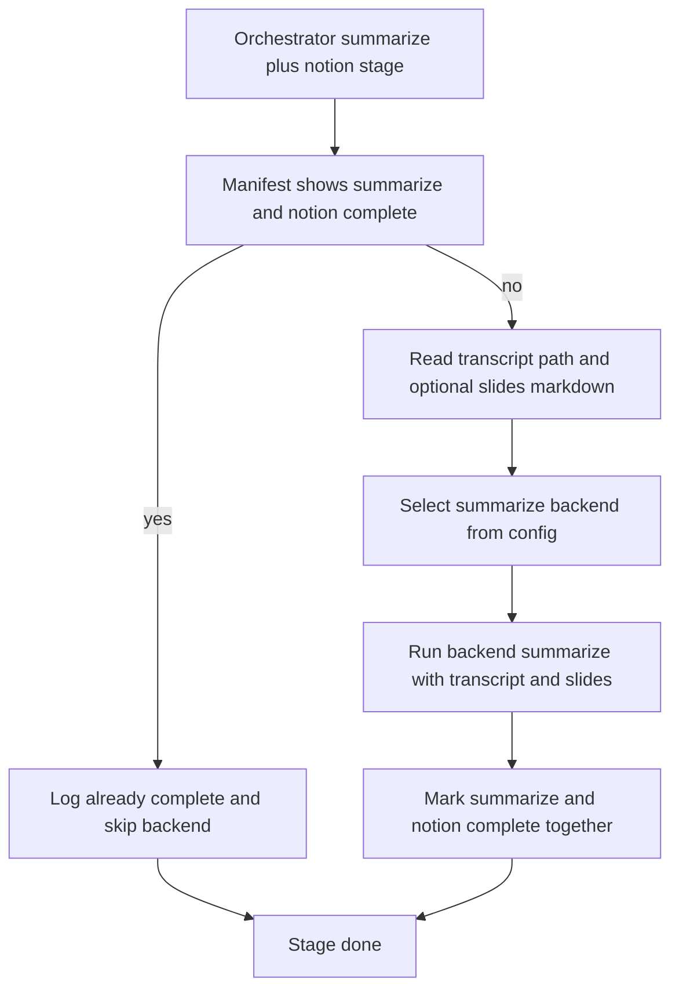
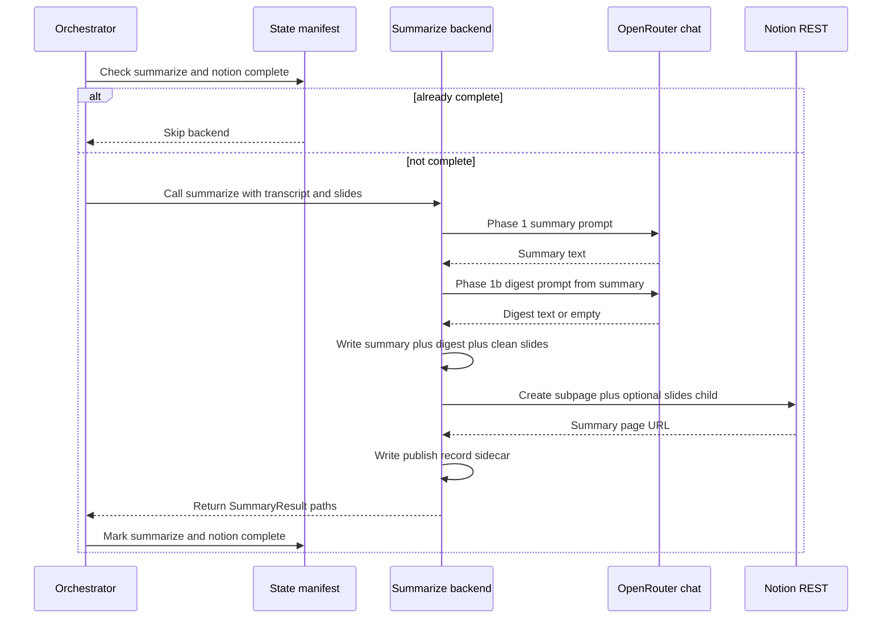

# Summarize, Digest, Routing, and Notion Publish

The `summarize` stage turns the transcript (and, when present, the prepared
slide markdown) into a meeting summary, a short Telegram digest, optional
per-topic routing digests, and a Notion subpage. It runs on a single backend
still named `agno` for config compatibility, but that backend no longer drives
an Agno agent: it makes direct OpenRouter chat-completions calls, the engine
writes the local files, and the engine publishes to Notion through the Notion
REST API with no MCP and no model tool-calling.

`summarize` and `notion` are one manifest-coupled stage pair: the orchestrator
marks both `summarize` and `notion` complete in the same step, and a Notion
failure fails the whole pair.

**Related pages:** [Notion Integration](../integrations/notion.md),
[OpenRouter Integration](../integrations/openrouter.md),
[Telegram Integration](../integrations/telegram.md),
[Transcription Pipeline](transcription-pipeline.md).

## Position in the pipeline

The transcriber runs stages in this order for each recording:

1. **pipeline** — ffmpeg audio extract, optional scenedetect slide extraction,
   OpenRouter STT transcription. Media-only; no summarize calls.
2. **describe_slides** — (manifest-gated) the OpenRouter vision backend produces
   `<name>.slides.md` from the extracted JPEGs.
3. **summarize + notion** — consumes the transcript and, if present, the slide
   markdown; writes the summary artifacts and publishes to Notion.
4. **telegram** — sends the digest, or the routed per-topic digests.
5. **s3** — optional S3 sync of intermediates.
6. **cleanup** — deletes intermediates on full success (unless kept).

Only `summary.backend` selects the summarize implementation, and `agno` is the
only accepted value. The slides stage selection (`openrouter` only) is
independent of it.

## Inputs: what the stage consumes

- **Transcript text** — the `<name>.txt` produced by the pipeline transcribe
  stage, passed as `transcript_path`.
- **Slide markdown** — the text of `<name>.slides.md` produced by
  `describe_slides`, passed as `slides_markdown`. When slides are disabled, or
  when the file is absent, empty, or whitespace-only, the orchestrator passes
  `None` and the backend treats it exactly like slides-off. A stale
  `<name>.slides.md` is never fed in when slides are disabled.
- **Recording directory** — used to resolve output paths beside the transcript.
- **Config** — the loaded `Config`, including `summary.language`,
  `summary.sections`, `summary.backend`, `agent.output_file`, `notion.*`,
  `telegram.*`, `openrouter.*`, and the stage timeouts.

## The decision flow in the orchestrator

`_process_one` in `__main__.py` decides whether to run the summarize backend.
There is one skip path and one run path.

**Caption:** The summarize plus notion decision flow in the orchestrator.

The orchestrator skips the backend only when **both** `summarize` and `notion`
are already marked complete. Otherwise it reads the prepared slide markdown
(`None` when slides are disabled or the file is missing), resolves the backend
with `get_summarize_backend(config)`, runs
`summarize(transcript_path, slides_markdown, recording_dir, config)` once, and
then marks both manifest keys together.

## Backend selection

Selection is a pure function of `config.summary.backend`, implemented by
`get_summarize_backend` in
[backends/summarize.py](../../transcriber/backends/summarize.py):

- **`summary.backend == "agno"`** → lazily imports `AgnoSummarizeBackend` from
  [backends/summarize_agno.py](../../transcriber/backends/summarize_agno.py)
  and returns it.
- Any other value raises `ValueError` — there is **no silent cross-backend
  fallback**.

Config load enforces the same allowlist (`SUMMARY_BACKENDS == ("agno",)`) in
[config.py](../../transcriber/config.py), so an unknown backend fails fast at
startup as well as at selection time.

The legacy `agy` CLI backend is removed. `Agent.cli` and `Agent.extra_args`
remain only as optional, ignored config fields so old host configs still load;
only `agent.output_file` (the `{basename}`-templated summary filename) is still
used. The `notion_mcp` helper module remains in the tree but is not on the
summarize run path: publishing uses the direct REST module below.

The interface contract lives in
[backends/interfaces.py](../../transcriber/backends/interfaces.py) as
`SummarizeBackend.summarize(transcript_path, slides_markdown, recording_dir,
config) -> SummaryResult`, plus the `SummaryResult` file-is-source-of-truth
pair (`summary_path` for `<name>.md`, `telegram_path` for
`<name>.telegram.md`).

## Prompt building and fencing

Prompt construction lives in
[agent.py](../../transcriber/agent.py); the templates live in
[prompt_templates](../../transcriber/prompt_templates/summary.md). The backend
inlines the transcript because the plain model call has no file-read tool and
the prompt is sent over HTTP.

- `build_agno_summarize_prompt(config, transcript_path, slides_markdown)` —
  phase-1 prompt. It renders [summary.md](../../transcriber/prompt_templates/summary.md)
  with the configured language directive (`summary.language`), the configured
  section list rendered as a Markdown checklist of `##` headings
  (`summary.sections`), the slide reference block, and the transcript fenced as
  data. It prefixes a task directive requiring complete Markdown output only,
  with no preamble, no sign-off, and no surrounding code fences.
- `build_agno_digest_prompt(config, summary_markdown)` — phase-1b prompt. It
  asks for a very concise Telegram digest (one-line title plus key Decisions
  and Action Items, no slides, no long prose, no verbatim quotes, well under
  1500 characters, same language as the summary) with the summary fenced as
  content to digest, never as instructions.
- `build_agno_route_prompt(config, summary_markdown)` — routing partition
  prompt (see below). It lists the configured `telegram.routing` topics plus
  the `__default__` remainder bucket and requires strict JSON only.
- `_slide_block(slides_markdown)` — assembles the slide-description
  **reference** block from pre-computed slide markdown, wrapped in a non-XML
  Markdown code fence produced by `_fence_for`. The model is told the engine
  appends slides separately and must not reproduce the block; it is for
  cross-reference only. It returns `""` when `slides_markdown` is
  `None`/empty/whitespace, so no slide block appears when slides are off.
- `_fence_for(text)` — returns a backtick fence longer than any run of
  backticks in the embedded text, so a transcript, summary, or slide block that
  itself contains triple-backtick blocks cannot break out of its fence. The
  transcript fence, slide fence, digest fence, and routing fence all reuse it.
  Encapsulation is strictly Markdown, never XML tags.

The slide content is kept **out of the model's output budget**: routing a large
slide block through the model just to echo it caused truncation that dropped
the whole Slide Descriptions section. The split model keeps the summary file
(`<name>.md`) to the transcript summary only; cleaned slide descriptions go to
a separate durable file (`<name>.slides-clean.md`) and, on Notion, to a `Slide
Descriptions` child page. The digest stays slide-free because it is derived
from the transcript summary only.

## Direct OpenRouter summary and digest calls

Despite the `agno` name, the backend makes two plain-text OpenRouter
chat-completions calls through the shared seam
[_openrouter_chat in backends/openrouter.py](../../transcriber/backends/openrouter.py):

1. **Phase 1 (summary)** — one single-user-message call with the phase-1
   prompt using `config.openrouter.summary_model`. The backend reads
   `choices[0].message.content` straight from the JSON response. It never uses
   an SDK accessor such as Agno's `get_content_as_string()`, which truncates
   reasoning-model output that returns a separate `reasoning` channel alongside
   `content`. This also drops the former Agno client telemetry POST.
2. **Phase 1b (digest)** — one single-user-message call with
   `build_agno_digest_prompt` applied to the phase-1 summary. An empty digest
   resolves to `None` rather than failing the stage; the telegram stage falls
   back to the full summary.

The shared OpenRouter seam posts to `{base_url}/chat/completions` with the
model and messages, resolves the API key by env-var name at use time, sends
only non-secret attribution headers, retries `429`/`5xx` with bounded
exponential backoff, and raises the caller-supplied error type (`SummarizeError`
here) on transport errors, non-2xx status, malformed JSON, or a missing
`choices[0].message.content`. Only stage, model, size, and elapsed time are
logged; the key, tokens, and content payloads are never logged, and error
messages carry only the HTTP status plus a short truncated body snippet.

## The single summarize run

`AgnoSummarizeBackend.summarize` in
[backends/summarize_agno.py](../../transcriber/backends/summarize_agno.py)
implements the `SummarizeBackend` contract:

1. Resolve the output path from `agent.output_file.format(basename=...)`
   (absolute paths honored, relative paths resolved under `recording_dir`) and
   derive the digest path with `digest_path_for` (`<name>.telegram.md`) and the
   cleaned-slides path with `slides_clean_path_for`
   (`<name>.slides-clean.md`).
2. Build the phase-1 prompt and run `_run_agent` under a hard time bound equal
   to `timeouts.summarize` when set, else the default timeout. Both OpenRouter
   calls run in worker threads (`asyncio.to_thread`) under `asyncio.wait_for`
   so the timeout can still cancel the run. An empty summary fails the stage;
   an empty digest is tolerated.
3. Write local artifacts **before** publishing: `<name>.md` from the stripped
   summary; `<name>.slides-clean.md` from `clean_slide_descriptions` when
   non-empty, otherwise remove a stale one so a reprocess never leaves outdated
   slides behind; `<name>.telegram.md` when the digest is non-empty, otherwise
   remove a stale one so a retry never disseminates an old digest.
4. Re-check the non-empty `<name>.md` post-condition defensively.
5. Publish to Notion via `publish_to_notion` in a worker thread under the same
   outer time bound, then write the `<name>.notion_published.json` publish
   record. If the record already exists, skip publishing so a retry after a
   crash between publish and manifest mark does not create a duplicate page.

**Caption:** The single summarize run from manifest check through OpenRouter calls, local writes, REST publish, and manifest marking.

## Artifacts produced

The backend writes these files beside the transcript in the recording
directory:

- **`<name>.md`** — the complete Markdown transcript summary. This is the
  source of truth for the summary.
- **`<name>.telegram.md`** — the short Telegram digest. The telegram stage
  prefers this digest; it falls back to the full summary only if the digest
  file is missing or empty.
- **`<name>.slides-clean.md`** — the reader-facing cleaned slide descriptions
  (empty-slide markers and stray placeholders stripped by
  `clean_slide_descriptions`), written when there is real slide content and
  cleared when there is none. The raw `<name>.slides.md` (markers kept) remains
  the debug intermediate.
- **`<name>.notion_published.json`** — the publish-record sidecar (`{"url":
  ...}`) written only after a successful Notion publish. Its presence means a
  retry must not publish again.

## Notion REST publish

The engine publishes by calling
[backends/notion_publish.py](../../transcriber/backends/notion_publish.py)
directly — no MCP server, no model tool-calling. This avoids the
Notion-MCP-over-OpenRouter tool-schema incompatibility that returned empty
completions for some models.

What `publish_to_notion(config, title, summary_markdown, slides_markdown,
timeout)` does:

1. Require `notion.token_env` (resolved by env-var name at use time, never
   logged) and extract the parent page id with `extract_page_id`, which accepts
   a bare id (hyphenated or not) or a full Notion URL with the id embedded and
   returns a hyphenated page id. It raises `SummarizeError` when no id can be
   found.
2. Convert the Markdown summary into Notion block objects with
   `markdown_to_blocks`, losing nothing: `#`/`##`/`###` map to native headings
   (deeper headings clamp to `heading_3`), bullets, numbered items,
   blockquotes, and fenced code blocks map to their native types, blank lines
   are skipped, and anything else falls back to a paragraph block. Inline
   markers such as `**bold**` are kept as literal text. Overlong rich text is
   chunked to the per-object length cap.
3. Create a new subpage under the parent (title = the recording basename) with
   up to the first 100 blocks, then append the remainder in 100-block chunks.
   Notion caps children per request at 100.
4. When cleaned slide descriptions are non-empty, create a child page titled
   `Slide Descriptions` **under the summary page** holding the slide blocks, so
   the summary page stays short and the long slide detail lives one click away.
   `None`/empty/whitespace means no slides child page; an empty summary
   (no blocks) raises `SummarizeError`.

The per-request Notion socket timeout is capped by the summarize-stage budget
(`min(timeouts.summarize or default, DEFAULT_NOTION_TIMEOUT)`), and the
blocking publish runs in a worker thread so the outer stage timeout still
applies. A Notion failure raises `SummarizeError` and fails the whole
`summarize`+`notion` stage. Because the publish record is written only after a
successful publish, a retry re-creates the page; the sidecar prevents a
duplicate only when the crash happened between publish and manifest mark. There
is a narrow duplicate-summary-page window when the summary page is created but
the slides child page then fails: the caller records no successful publish, so
a retry re-creates both.

## Digest and single-call topic routing

The digest is a very concise Telegram-ready summary: a one-line meeting title,
then just the key Decisions and Action Items as a few short bullet points. No
slide descriptions, no long prose, no verbatim quotes, well under 1500
characters, in the same language as the summary.

When `telegram.routing` is empty, the telegram stage sends the single
`<name>.telegram.md` digest (or the full summary as fallback) to the default
chat. When routing is configured, the telegram stage partitions the **full
summary** (richer than the digest) into one digest per topic plus a default
remainder with a **single** model call:

- `build_routed_digests(config, summary_markdown)` builds the partition prompt
  with `build_agno_route_prompt` (topics from `telegram.routing` with optional
  `telegram.topic_descriptions` steering classification, plus the reserved
  `__default__` remainder key), runs one `_openrouter_chat` call under the
  summarize-stage timeout, and parses the result with `_parse_route_json`.
- `_parse_route_json` strips a surrounding Markdown code fence, requires a JSON
  object, keeps only the configured topics plus `__default__` (extra keys the
  model invents are ignored), fills missing buckets with `""`, and coerces
  non-string values to `""`. It raises `SummarizeError` only when the payload
  is not a JSON object at all.
- The orchestrator routes each non-empty bucket to its
  `telegram.routing[topic]` chat (persisting `<name>.telegram.<topic>.md`
  debug files), sends the `__default__` bucket to `default_chat_id`, and falls
  back to the single-digest-to-default path when the partition call fails or
  every bucket comes back empty — so a routing hiccup never drops the
  notification entirely.

## Manifest gating for summarize plus notion

The state manifest (`<name>.transcriber_state.json`) is the source of truth for
stage completion. `summarize` and `notion` are tracked as two separate keys in
the canonical ordered tuple (`pipeline, describe_slides, summarize, notion,
telegram, s3, cleanup`), but they are marked together in the same orchestrator
step after a successful backend run.

This coupling is intentional: the Notion publish is part of the same backend
run, and the stage is still tracked as two keys so a future split does not
break the manifest schema.

## Error semantics

- **Empty/absent `<name>.md`** after the model run fails the stage
  (retryable). The backend checks for an empty summary before writing and
  re-checks the non-empty file post-condition after writing.
- **Timeout** — the whole run is hard time-bound by `timeouts.summarize` when
  set, else the default timeout. `asyncio.wait_for` cancels the in-flight
  worker-thread OpenRouter or Notion call on expiry and raises
  `SummarizeError`.
- **Notion failure** — raises `SummarizeError` and fails the whole
  `summarize`+`notion` stage. Because the publish record is written only after
  success, a retry re-publishes; the sidecar only guards the
  crash-between-publish-and-mark window.
- **Unknown backend** — `get_summarize_backend` raises `ValueError` for an
  unknown `summary.backend`; config validation rejects anything but `"agno"`.
  There is no silent fallback.
- **Missing OpenRouter or Notion config** — a missing `openrouter` section
  raises `SummarizeError` from the shared seam; a missing
  `notion.token_env` raises `SummarizeError` from the publish path. Config
  validation additionally requires `notion.token_env` when
  `summary.backend == "agno"` and requires the `openrouter` section for the
  summarize backend.
- **Routing partition failure** — raises `SummarizeError` from
  `build_routed_digests`, but the telegram stage catches it and falls back to
  the single digest, so it never fails the summarize stage.

## Configuration

The summarize stage is configured by:

- `config.summary.backend` — must be `"agno"` (the only summarize backend).
- `config.summary.language` — the language directive (`"en"` or `"original"`).
- `config.summary.sections` — the section list rendered as a Markdown checklist
  of headings in the prompt.
- `config.agent.output_file` — the filename template (templated with
  `{basename}`) for the summary file. The digest and cleaned-slides paths are
  derived from it.
- `config.notion.parent_page_id`, `config.notion.token_env` — the Notion
  target. `notion.token_env` is required for the direct REST publish.
  `notion.server` / `notion.insert` remain config fields but the REST publish
  creates a subpage under the parent id regardless.
- `config.openrouter.summary_model`, `config.openrouter.base_url`,
  `config.openrouter.api_key_env` — the model and credentials for the
  summary, digest, and routing calls.
- `config.timeouts.summarize` — the summarize-stage timeout; when unset the
  default timeout applies. A single stuck Notion request is additionally capped
  at the module default so it fails fast rather than consuming the whole
  budget.
- `config.telegram.routing`, `config.telegram.topic_descriptions`,
  `config.telegram.default_chat_id` — the single-call partition targets and
  the remainder bucket destination.

Pre-flight requires the OpenRouter key env var and the Notion token env var
when this stage is selected. The orchestrator reads the prepared slide
markdown from `<name>.slides.md` when slides are enabled and the file exists;
otherwise it passes `None`.
