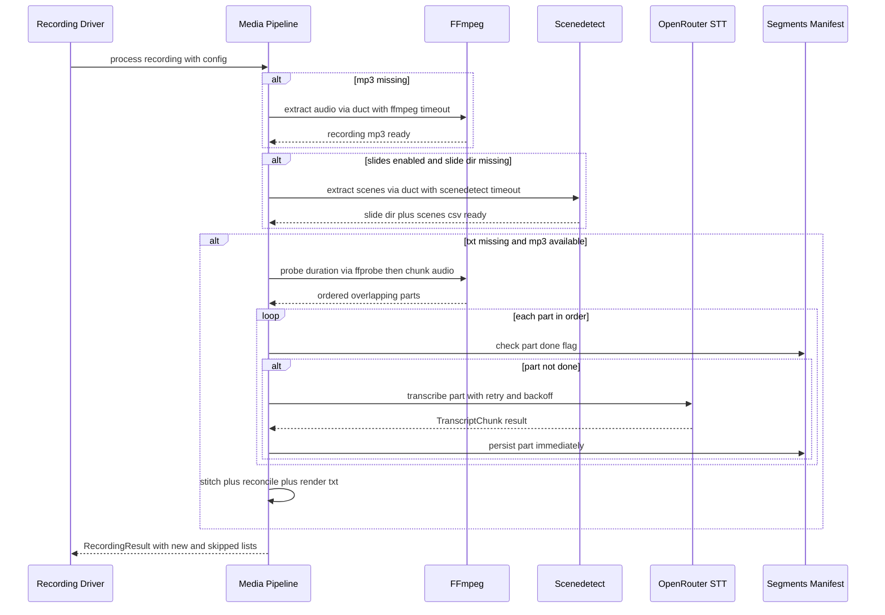

# Workflow — Deterministic Transcription Pipeline

The transcription pipeline is the deterministic media stage that turns a source `.mp4` into a plain-text transcript. It is owned by the media pipeline module and is intentionally **ffmpeg plus scenedetect plus OpenRouter STT only**: the pipeline does not call slides or summarize backends; those live in the manifest-gated orchestrator that runs after the media stage completes.

The pipeline lives in `transcriber/pipeline.py` and delegates the OpenRouter STT stage — including chunking, stitching, speaker reconciliation, and the per-segment manifest — to `transcriber/backends/transcribe_openrouter.py`. The driver is `process_recording(mp4, config)` in `pipeline.py`, which returns a `RecordingResult(name, mp4, new_artifacts, skipped_artifacts)`. The batch entry point is `process_all(config)`, which runs `process_recording` over every `.mp4` under `config.recordings_dir` in sorted order.

> Related pages: [OSS Companion Transcriber](../architecture/oss-companion-transcriber.md), [Pre-flight and Idempotency](../operations/pre-flight-and-idempotency.md), [Slides Description](slides-description.md), [OpenRouter Integration](../integrations/openrouter.md).

## Pipeline data flow

The media stage is a short linear chain with a network seam only in the transcribe stage. The diagram below shows the call sequence and stage handoffs, including the manifest guarded by the transcribe backend.



*Call sequence from source MP4 through audio extract, optional scene extract, chunked STT, manifest-guarded stitching, and result reporting.*

Each child-process call in `pipeline.py` runs through `_run_command(argv, timeout, stdout_path=None)`, the sole seam for external binaries. It builds a `duct.cmd(*argv)` expression, optionally redirects stdout to a file, polls every `0.1` seconds until the deadline, kills the child and raises `PipelineTimeoutError` on expiry, and lets non-zero exits surface as `duct.StatusError`. Tests monkeypatch this seam so no real binary runs.

## Stage 1 — Audio extract (ffmpeg)

`_extract_audio(mp4, mp3, timeout)` mirrors the source ffmpeg flags for the audio-only pass:

```bash
ffmpeg -hide_banner -loglevel error -i <mp4> -vn -c:a libmp3lame -q:a 2 <mp3>
```

The timeout comes from `config.timeouts.ffmpeg` (default `900` seconds). The pipeline treats `<name>.mp3` as an idempotent artifact: if it already exists, the stage is skipped and recorded in `skipped_artifacts`, while `have_mp3` is still set to true so the downstream transcribe stage sees the audio as available. If the mp3 does not exist, ffmpeg runs and the mp3 is produced in the same recording directory. The mp3 feeds both the optional slide extraction and the transcribe stage, but only the transcribe stage is gated on it via the `have_mp3` guard.

## Stage 2 — Slide and scene extraction (optional, scenedetect)

When `config.stages.slides.enabled` is true, `_extract_slides(mp4, slides_dir, scenes_csv, timeout)` runs scenedetect to produce a slide-image directory and a scenes CSV. The timeout comes from `config.timeouts.scenedetect`. The command mirrors the source:

```bash
scenedetect -b pyav -i <mp4> -o extracted_slides.<name> detect-content --threshold 30 --min-scene-len 5s list-scenes -f <name>.scenes.csv save-images -n 1
```

The output directory is `recordings_dir / extracted_slides.<name>`. If that directory already exists the stage is skipped. This stage is media-only and deterministic. It is not the paid slides backend: the paid `describe_slides` stage (OpenRouter vision) runs later in the manifest-gated orchestrator and consumes the slides that this stage extracted. This stage is present in the dry-run plan only as the `scene-extract` token, which is distinct from `describe-slides`.

## Stage 3 — Transcribe (OpenRouter STT, chunked, diarized)

`_transcribe(mp3, txt, config)` delegates to `transcribe_recording(mp3, txt, config)` in `transcribe_openrouter.py`. That function is the transcribe stage entry point and owns chunking, per-part transcription via the OpenRouter HTTP seam, stitching onto a monotonic timeline, speaker reconciliation across chunk boundaries, final rendering, and writing `<name>.txt`.

Chunking uses `config.transcribe.segment_seconds` (default `480`) and `config.transcribe.overlap_seconds` (default `5`), and diarization follows `config.transcribe.diarize` (default true) plus `config.transcribe.model_id` (default `microsoft/mai-transcribe-2`). The language hint comes from `config.summary.language` and is sent only when it is the recognized English hint; otherwise it is omitted for auto-detection. The per-request HTTP timeout comes from `config.timeouts.transcribe`, while chunking ffmpeg calls reuse `config.timeouts.ffmpeg` and the duration probe uses a fixed `120` second timeout.

The per-recording work dir is `recordings_dir / transcribe_work.<name>` and carries a `segments.json` manifest. The manifest is the source of truth inside the transcribe stage: completed parts are read from it and never re-issued, so a retry after a failure does not re-pay already-completed segments. The manifest also holds a parameter guard on `segment_seconds` and `overlap_seconds`, so a config change discards the work dir and forces a rechunk.

The pipeline per-recording driver skips the transcribe stage entirely when `<name>.txt` already exists, in keeping with the media stage idempotent-by-artifact contract. Inside the transcribe stage, per-segment idempotency is finer-grained and is owned by `segments.json`.

### Chunker and explicit time slices

Chunking is implemented by `chunk_audio(mp3, work_dir, segment_seconds, overlap_seconds, timeout, duration_seconds=None)`. It slices a long `<name>.mp3` into ordered, overlapping parts, one ffmpeg call per part:

```bash
ffmpeg -ss <k*segment_seconds> -t <segment_seconds + overlap_seconds> -i <mp3> -c copy <work_dir>/part_{k:03d}.mp3
```

This uses **explicit time-sliced ffmpeg calls rather than `-f segment`** because the segment muxer has no overlap option. Overlapping parts let speaker reconciliation across chunk boundaries align per-request provider labels in the shared tail window. With `-f segment` there is no way to express that overlap, so the pipeline emits one explicit `-ss` and `-t` call per part through the same `_run_command` seam the rest of the pipeline uses.

Each part `k` starts at `k * segment_seconds` and runs for `segment_seconds + overlap_seconds`, so successive parts share an overlap window. The number of parts is `max(1, ceil(duration_seconds / segment_seconds))` when a duration is known, otherwise a single part is cut (short clips and tests). The production source of `duration_seconds` is `_probe_duration_seconds(mp3)`, a best-effort `ffprobe` call through the pipeline monkeypatchable seam that writes to a sibling duration file and deletes it afterwards; when the duration cannot be determined, chunking falls back to a single part rather than crashing.

### OpenRouter STT seam

`_openrouter_transcribe(config, audio_path, model, diarize, language, timeout)` transcribes exactly one audio part and returns one `TranscriptChunk`. It posts to `POST {base_url}/audio/transcriptions` with a JSON base64 body: the audio is read as bytes, base64-encoded as `input_audio.data` with `format: "mp3"`, and sent as raw base64 — not a `data:` URI.

Diarization semantics:

- When `diarize` is true, the request uses `response_format: "verbose_json"` and merges a per-model provider diarization block for `microsoft/mai-transcribe-2` (the only model with a registered toggle). The toggle is keyed by a substring of the model slug so both `microsoft/mai-transcribe-2` and a bare `mai-transcribe-2` match.
- An unknown model sends `verbose_json` without a provider toggle and relies on native diarization, failing cleanly on a 400 if unsupported.
- When `diarize` is false, the toggle is omitted and the result is emitted as flat text.

Response parsing prefers `segments`, falls back to `words` grouped into per-speaker turns, and degrades to flat `raw_text` with a warning when diarization yields no parseable shape.

Retry behavior is bounded: `429`, `500`, `502`, `503`, and `504` are retried with exponential backoff up to `MAX_ATTEMPTS = 4` total tries. A `400` is not retryable: it fails immediately with no silent fallback. Transport errors (`httpx.HTTPError`) are also retried within the cap. Any other non-2xx after retries raises `TranscribeError`. The API key, request headers, and base64 audio payload are never logged or embedded in exceptions; errors carry only the HTTP status and a short truncated body snippet.

### Stitch

`stitch(chunks, segment_seconds)` offsets each chunk segment times onto a monotonic global timeline. Each chunk segments are shifted by its cumulative start (`index * segment_seconds`), and the returned chunks have `offset` set and `start` and `end` globalised.

### Reconcile speakers

`reconcile_speakers(chunks, segment_seconds, overlap_seconds)` maps per-chunk provider labels onto a persistent global speaker registry. It expects stitched chunks with global timestamps. For the first chunk, each distinct local speaker label is assigned a new global id in order. For each later chunk, local labels are aligned to the global registry using the overlap window shared with the previous chunk: a local speaker whose overlapping-region segments align by time inherits that global id, with a text match nudging weak temporal overlaps. An unmatched local speaker — silent in the overlap window — gets a new global id and a logged warning; it is never force-merged or dropped. The function returns a single flat, time-ordered list of `SpeakerSegment` objects whose `speaker` fields are global ids.

Duplicate transcription in the shared leading overlap window is handled explicitly: chunk 0 emits all of its segments; chunk `k > 0` skips the window `[offset, offset + overlap)` because those segments are duplicate transcriptions of the previous chunk tail.

### Render transcript

`render_transcript(segments, chunks, diarize)` produces the final text. When diarization produced labelled segments, consecutive same-global-speaker segments are grouped into `Speaker <ID>: <text>` lines with **no timestamp markers**. When there are no labels anywhere, or `diarize == false`, it returns the flat stitched text — chunk `raw_text` concatenated in index order.

### Per-segment manifest and idempotency

`transcribe_recording` writes a `segments.json` manifest under the work dir. The manifest records `segment_seconds`, `overlap_seconds`, and a per-part list with each part `index`, `done` flag, `cost`, `raw_text`, `segments`, and local path. On a fresh run, the audio is chunked and each part is transcribed in order; completed parts are persisted immediately into the manifest so a later failure does not re-issue that part. On a resume, parts already marked `done` are read back from the manifest and never re-sent to OpenRouter.

The manifest also implements a parameter guard: if the stored `segment_seconds` or `overlap_seconds` differ from the current config, the work dir is discarded and the audio is rechunked. This prevents stale overlapping parts from being replayed under new chunking parameters.

## Artifacts and result

The media stage produces up to three artifacts: `<name>.mp3`, `extracted_slides.<name>/` (optional, when slides are enabled), and `<name>.txt`. `process_recording` returns a `RecordingResult` listing which artifacts are new and which were skipped because they already existed. The orchestrator manifest-gated stages run after this media stage completes and are tracked separately by the per-recording state manifest.
